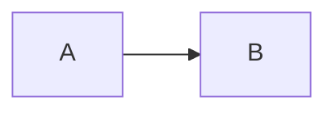

# Feature name

| | |
|---|---|
| **Status** | Planned / In progress / Stable / Deprecated |
| **Since** | vX.Y.Z (YYYY-MM-DD) |
| **Updated** | vX.Y.Z (YYYY-MM-DD) |
| **Code** | `engine/...` |
| **ADRs** | [NNNN](../adr/NNNN-....md) |

## Summary
What problem it solves, in 2–3 lines.

## Spec
What it guarantees. Known limits. What it does *not* do (yet).

## Design
Components and dependencies. Diagram if useful:

## API
Main public functions/types with a minimal example.

## Decisions
One line per choice; link ADRs for the important ones.

## Future work

## History
| Version | Date | Change |
|---|---|---|
| vX.Y.Z | YYYY-MM-DD | First version |
