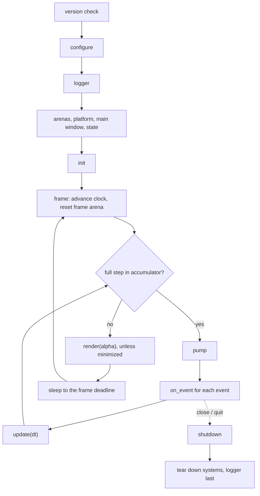

# Application lifecycle

| | |
|---|---|
| **Status** | In progress |
| **Since** | v0.1.0 (2026-11-16) |
| **Updated** | v0.1.0 (2026-11-16) |
| **Code** | `engine/include/reborn/app.h`, `engine/src/app/` |
| **ADRs** | [0011](../adr/0011-application-layer-and-game-loop.md) |

## Summary
The engine owns the game loop. A game is a set of callbacks: the engine starts its systems, opens
the main window, allocates the game's state, runs fixed simulation steps and one render per frame,
and shuts everything down. Timing, frame memory and event handling are written once.

## Spec
- **Phases:** `configure` (before any system, receives the defaults) → `init` (systems, window and
  state ready) → loop → `shutdown` (systems still alive). Only `update` is required.
- **Process setup:** `rb_app_run` first checks that the game was compiled against the linked
  engine's headers (an inline function in `app.h`, so the game's `RB_VERSION_NUMBER` reaches the
  library), then calls `configure`, then starts the logger with `config.log` (default: console
  INFO, no file), and stops it last. `main` is one line; do not start the logger yourself.
- **Failure:** a version mismatch, `configure` or `init` returning `false`, an invalid config, or a
  failed startup make `rb_app_run` return 1 (logged). `shutdown` is not called when `init`
  failed. A log file that cannot be opened is only a warning.
- **Fixed step:** `update(dt)` runs `update_rate` times per second (1..1000, default 60), with
  `dt = 1 / update_rate`. The first frame runs one step at once. Frame deltas are clamped to
  250 ms, which bounds the steps per frame (15 at 60 Hz).
- **Step = pump + events + update:** each step pumps the platform, gives every event to
  `on_event`, then updates. `rb_key_was_pressed` covers exactly the time since the previous step.
  Events and input reach the game only at step boundaries.
- **Render:** once per frame, with `alpha` in [0, 1) = leftover time / step. Skipped while the main
  window is minimized, and the loop then sleeps until the next step is due.
- **Quit:** a close request on the main window (after `on_event` saw it) or `rb_app_quit`. The
  loop ends after the current step's events, or after the current frame.
- **Logging:** each phase once, never per frame. INFO: the configuration as received (`Config:`
  lines, before validation), `App started`, the quit reason (`Quit: main window close requested` /
  `Quit: requested by the game`), the run's totals. DEBUG: `Game init`, `Loop started`,
  `Game shutdown`.
- **Frame cap:** `max_fps` (default 60, `RB_APP_FPS_UNCAPPED` for none), paced on absolute
  deadlines: sleep overshoot does not lower the average rate. A frame late by a period or more
  restarts the schedule.
- **Memory:** a persistent arena (platform state, game state, game data for the whole run; 256 MiB
  reserved) and a frame arena reset at the start of every frame (64 MiB reserved). The state is
  zeroed and aligned as configured (`RB_APP_STATE`).
- **Not yet:** vetoing the close, variable update, several windows managed by the app, events
  between steps.

## Design

`frame_timing.c` holds the accumulator (`rb_step_clock`) and the pacer (`rb_frame_pacer`). Both are
pure functions of times passed in, so their tests use made-up clocks. `app.c` wires them to the
real clock, the platform and the arenas.

## API
```c
typedef struct game_state { f32 x, prev_x; } game_state;

static bool game_configure(rb_app_config *config) {
    config->window.title = "My game";
    RB_APP_STATE(config, game_state);
    return true;
}
static void game_update(void *state, rb_app *app, f64 dt) {
    game_state *game = state;
    game->prev_x = game->x;
    if (rb_key_is_down(rb_app_platform(app), RB_KEY_D)) game->x += (f32)(100.0 * dt);
}
static void game_render(void *state, rb_app *app, f64 alpha) {
    game_state *game = state;
    f32 x = game->prev_x + (game->x - game->prev_x) * (f32)alpha; /* draw at x */
}

static const rb_app_callbacks game = {
    .configure = game_configure, .update = game_update, .render = game_render};

int main(void) {
    return rb_app_run(&game);
}
```
Accessors from a callback: `rb_app_platform`, `rb_app_window`, `rb_app_persistent_arena`,
`rb_app_frame_arena`, `rb_app_quit`.

## Decisions
- Engine owns the loop, game provides callbacks (ADR 0011, A1); `configure` separate from `init` (B2).
- Fixed timestep with accumulator and `alpha` (C2); one pump per step (D1).
- Opaque `rb_app *` with accessors (E1); state allocated by the engine from its declared size (F1).
- Frame cap on absolute deadlines until vsync (G1).
- `rb_app_run` owns version check and logger, `main` is one line (H2).

## Future work
- Veto on close; variable `update` for camera/UI if needed (ADR 0011, C4).
- Vsync from the swapchain (§7) replaces the cap as the pacer.
- Hot-reload of game code as a DLL; LLM debug API stepping the simulation.
- Engine-provided entry point `reborn/entry.h` (`main` / `WinMain`), the game only returns its
  callbacks (ADR 0011, H3).
- Win32 modal loop: run during window drags.

## History
| Version | Date | Change |
|---|---|---|
| v0.1.0 | 2026-11-16 | First version: callbacks, fixed step, frame cap, persistent and frame arenas |
