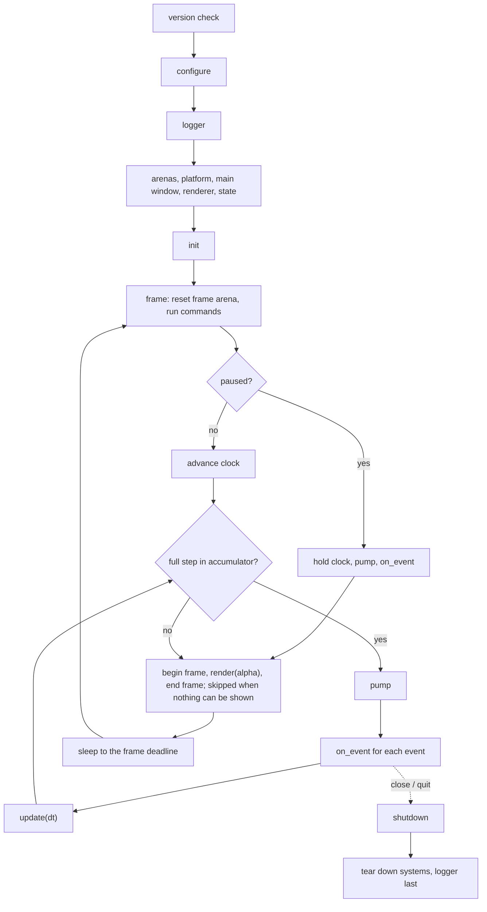

# Application lifecycle

| | |
|---|---|
| **Status** | In progress |
| **Since** | v0.1.0 (2026-11-16) |
| **Updated** | v0.2.0 (2026-11-27) |
| **Code** | `engine/include/reborn/app.h`, `engine/src/app/` |
| **ADRs** | [0011](../adr/0011-application-layer-and-game-loop.md), [0012](../adr/0012-allocation-tracking.md), [0013](../adr/0013-vulkan-renderer.md), [0022](../adr/0022-command-system.md), [0025](../adr/0025-frame-statistics.md) |

## Summary
The engine owns the game loop. A game is a set of callbacks: the engine starts its systems, opens
the main window, allocates the game's state, runs fixed simulation steps and one render per frame,
and shuts everything down. Timing, frame memory and event handling are written once.

## Spec
- **Phases:** `configure` (before any system, receives the defaults) → `init` (systems, window and
  state ready) → loop → `shutdown` (systems still alive). Only `update` is required.
- **Process setup:** `rb_app_run(&callbacks, argc, argv)` first checks that the game was
  compiled against the linked engine's headers (an inline function in `app.h`, so the game's
  `RB_VERSION_NUMBER` reaches the library), then reads the engine's options (`--script`,
  `--listen`, `--help`; anything else fails the run), then calls `configure`, then starts the
  logger with `config.log` (default: console INFO, no file), and stops it last. `main` is one
  line; do not start the logger yourself.
- **Commands:** once per frame, before the steps, from the script and the local server; game
  commands registered in `init`. The pause stops `update`, not events or `render`. See
  [commands.md](commands.md).
- **Frame statistics:** the loop times each frame (interval, waits, steps, render) and publishes a
  window of about a second: `rb_app_get_frame_stats` (ADR 0025, [statistics.md](statistics.md)).
- **Renderer:** started after the main window, stopped before it (`rb_app_renderer`), configured
  in `config.renderer`: validation on by default in debug builds of the engine, vsync on. It draws
  into the main window. A machine without Vulkan 1.3 fails the startup. See
  [renderer.md](renderer.md).
- **Failure:** a version mismatch, an unknown option, `configure` or `init` returning `false`, an
  invalid config, or a failed startup (Vulkan missing, script missing, port in use included) make
  `rb_app_run` return 1 (logged). `shutdown` is not called when `init`
  failed. A log file that cannot be opened is only a warning.
- **Fixed step:** `update(dt)` runs `update_rate` times per second (1..1000, default 60), with
  `dt = 1 / update_rate`. The first frame runs one step at once. Frame deltas are clamped to
  250 ms, which bounds the steps per frame (15 at 60 Hz).
- **Step = pump + events + update:** each step pumps the platform, gives every event to
  `on_event`, then updates. `rb_key_was_pressed` covers exactly the time since the previous step.
  Events and input reach the game only at step boundaries.
- **Render:** once per frame, with `alpha` in [0, 1) = leftover time / step, inside a renderer
  frame: `rb_renderer_begin_frame` before (which also rebuilds the swapchain after a resize),
  `rb_renderer_end_frame` after (submit and present). When begin says nothing can be shown
  (main window minimized or without pixels), render is skipped and the loop sleeps until the next
  step is due.
- **Quit:** a close request on the main window (after `on_event` saw it), `rb_app_quit` or the
  `quit` command. The loop ends after the current step's events, or after the current frame.
- **Logging:** each phase once, never per frame. INFO: the configuration as received (`Config:`
  lines, before validation), `App started`, the quit reason (`Quit: main window close requested` /
  `Quit: requested by the game`), the run's totals. DEBUG: `Game init`, `Loop started`,
  `Game shutdown`.
- **Frame cap:** `max_fps` (default `RB_APP_FPS_UNCAPPED`: with vsync the present paces frames,
  ADR 0013, X2; a number sets a cap on top), paced on absolute
  deadlines: sleep overshoot does not lower the average rate. A frame late by a period or more
  restarts the schedule.
- **Memory:** a persistent arena (platform state, game state, game data for the whole run; 256 MiB
  reserved) and a frame arena reset at the start of every frame (64 MiB reserved). The state is
  zeroed and aligned as configured (`RB_APP_STATE`). `rb_app_allocator` gives the game a
  general-purpose allocator (the heap) for objects freed one at a time, tagged
  `RB_MEMORY_TAG_GAME`.
- **Memory report:** at the end of the run (also after a failed `init`), once the platform is shut
  down and before the arenas go: per tag that allocated, its peak and totals (INFO); per tag still
  holding blocks, a `Memory leak` line (ERROR, exit code unchanged); per arena, its peak of
  reserved (INFO). See [memory.md](memory.md).
- **Not yet:** vetoing the close, variable update, several windows managed by the app, events
  between steps.

## Design

`frame_timing.c` holds the accumulator (`rb_step_clock`) and the pacer (`rb_frame_pacer`). Both are
pure functions of times passed in, so their tests use made-up clocks. `app.c` wires them to the
real clock, the platform and the arenas.

## API
```c
typedef struct game_state { f32 x, prev_x; } game_state;

static bool game_configure(rb_app_config *config) {
    config->window.title = "My game";
    RB_APP_STATE(config, game_state);
    return true;
}
static void game_update(void *state, rb_app *app, f64 dt) {
    game_state *game = state;
    game->prev_x = game->x;
    if (rb_key_is_down(rb_app_platform(app), RB_KEY_D)) game->x += (f32)(100.0 * dt);
}
static void game_render(void *state, rb_app *app, f64 alpha) {
    game_state *game = state;
    f32 x = game->prev_x + (game->x - game->prev_x) * (f32)alpha; /* draw at x */
}

static const rb_app_callbacks game = {
    .configure = game_configure, .update = game_update, .render = game_render};

int main(int argc, char **argv) {
    return rb_app_run(&game, argc, argv);
}
```
Accessors from a callback: `rb_app_platform`, `rb_app_window`, `rb_app_renderer`,
`rb_app_persistent_arena`, `rb_app_frame_arena`, `rb_app_allocator`, `rb_app_quit`,
`rb_app_is_paused`, `rb_app_step_index`, `rb_app_register_command`.

```c
/* Objects freed one at a time: freed by shutdown, or reported as a leak. */
rb_enemy *enemy = RB_ALLOC_TYPE(rb_app_allocator(app), rb_enemy, RB_MEMORY_TAG_GAME);
RB_FREE_TYPE(rb_app_allocator(app), enemy, rb_enemy, RB_MEMORY_TAG_GAME);
```

## Decisions
- Engine owns the loop, game provides callbacks (ADR 0011, A1); `configure` separate from `init` (B2).
- Fixed timestep with accumulator and `alpha` (C2); one pump per step (D1).
- Opaque `rb_app *` with accessors (E1); state allocated by the engine from its declared size (F1).
- Frame cap on absolute deadlines until vsync (G1).
- `rb_app_run` owns version check and logger, `main` is one line (H2).
- The engine chooses the game's general-purpose allocator and reports leaks and arena peaks at the
  end of the run (ADR 0012, D1).

## Future work
- Veto on close; variable `update` for camera/UI if needed (ADR 0011, C4).
- Hot-reload of game code as a DLL.
- Engine-provided entry point `reborn/entry.h` (`main` / `WinMain`), the game only returns its
  callbacks (ADR 0011, H3).
- Win32 modal loop: run during window drags.

## History
| Version | Date | Change |
|---|---|---|
| v0.1.0 | 2026-11-16 | First version: callbacks, fixed step, frame cap, persistent and frame arenas |
| v0.1.0 | 2026-11-16 | `rb_app_allocator`; memory report (leaks, arena peaks) at the end of the run |
| v0.1.0 | 2026-11-17 | Starts the renderer (`config.renderer`, `rb_app_renderer`) |
| v0.1.0 | 2026-11-17 | The renderer gets the main window; render skipped when the renderer cannot show a frame |
| v0.1.0 | 2026-11-17 | Render inside a renderer frame (begin / end); no frame cap by default, vsync paces |
| v0.2.0 | 2026-11-24 | `rb_app_run` takes `argc`/`argv`; commands each frame, pause and step (ADR 0022) |
| v0.2.0 | 2026-11-27 | Frame statistics: `rb_app_get_frame_stats` (ADR 0025) |
