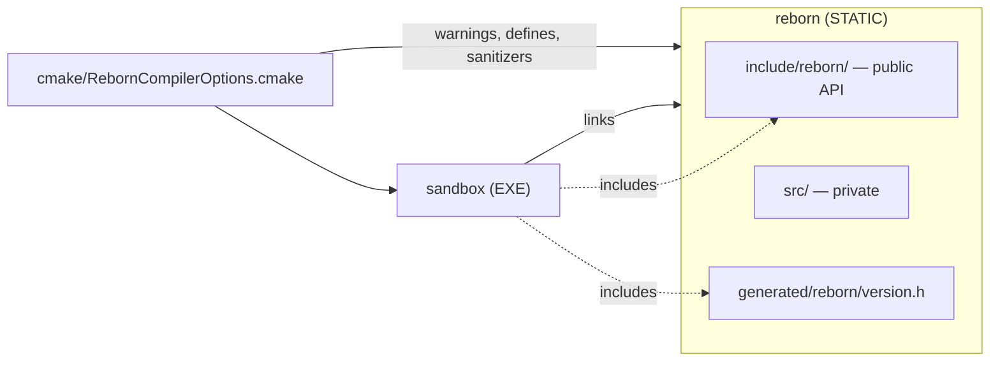
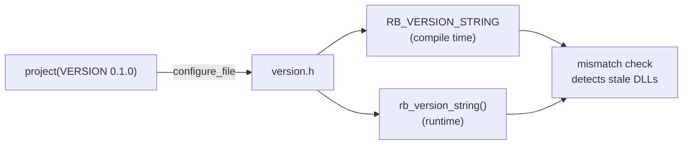
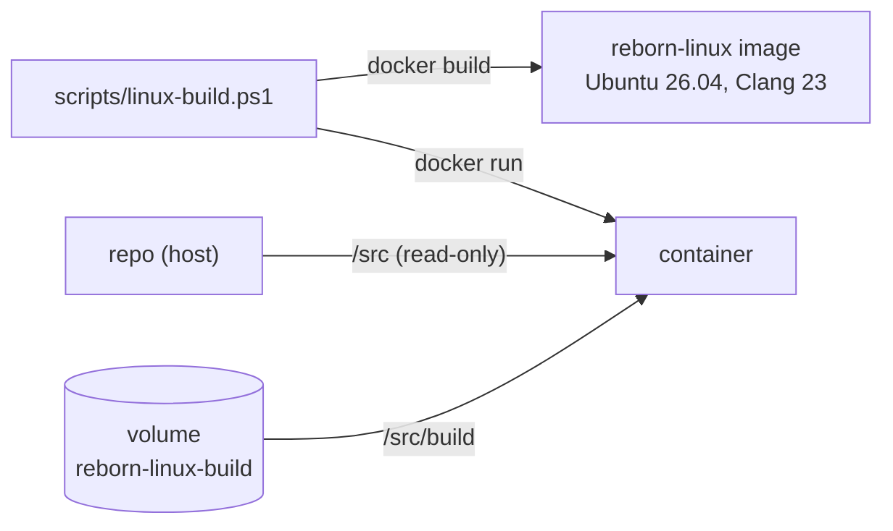

# Build system

| | |
|---|---|
| **Status** | Stable |
| **Since** | v0.1.0 (2026-11-15) |
| **Updated** | v0.1.0 (2026-11-15) |
| **Code** | `CMakeLists.txt`, `CMakePresets.json`, `cmake/`, `engine/CMakeLists.txt`, `engine/include/reborn/defines.h`, `docker/`, `scripts/linux-build.*` |
| **ADRs** | [0001](../adr/0001-build-system-compiler-standard.md), [0002](../adr/0002-static-engine-library.md), [0003](../adr/0003-versioning-and-repo-layout.md), [0005](../adr/0005-linux-build-container.md) |

## Summary
CMake + Ninja + Clang, C17. The engine is the static library `reborn`, used by the `sandbox`
executable. Provides the shared foundations (`defines.h`) and a single-source version.

## Spec
- Same toolchain and flags on Windows and Linux.
- C17 without compiler extensions; extended warnings on every target.
- Presets: `debug`, `release`, `debug-asan` (AddressSanitizer + UBSan).
- Version declared once, available at compile time and at runtime.
- Consumers only see `<reborn/...>`, never engine internals.
- Linux build verifiable from Windows through Docker (see below).
- Not yet: shader compilation, packaging, CI.

## Design



Version flow:



Linux build from Windows:



```powershell
./scripts/linux-build.ps1                          # debug: configure, build, run sandbox + ctest
./scripts/linux-build.ps1 debug release debug-asan # several presets, stops at first failure
./scripts/linux-build.ps1 -Shell                   # bash inside the container
docker volume rm reborn-linux-build                # wipe Linux build output
```

On a Linux/macOS host use `scripts/linux-build.sh` (`--shell` instead of `-Shell`).

## API

| Symbol | Purpose |
|---|---|
| `u8…u64`, `i8…i64`, `f32`, `f64`, `usize`, `isize` | fixed-width types |
| `RB_PLATFORM_WINDOWS` / `RB_PLATFORM_LINUX` | target platform |
| `RB_COMPILER_CLANG` / `_GCC` / `_MSVC` | compiler |
| `RB_API` | public symbol marker (export/import when `REBORN_SHARED=ON`) |
| `RB_DEBUG` / `RB_RELEASE` | build configuration |
| `RB_INLINE`, `RB_UNUSED`, `RB_ARRAY_COUNT`, `RB_KIB/MIB/GIB` | utilities |
| `rb_version_string()`, `rb_version_number()` | version of the linked engine |

CMake options: `REBORN_SHARED`, `REBORN_WARNINGS_AS_ERRORS`, `REBORN_ENABLE_SANITIZERS`, `REBORN_BUILD_SANDBOX`,
`REBORN_BUILD_TESTS` (see [unit-testing.md](unit-testing.md)). Each configure preset has a matching test preset.

## Decisions
- CMake + Ninja + Clang + C17 → [ADR 0001](../adr/0001-build-system-compiler-standard.md).
- Static engine with `RB_API` in place → [ADR 0002](../adr/0002-static-engine-library.md).
- `RB_DEBUG` instead of `NDEBUG`: we decide what stays enabled in release.
- Version packed like `VK_MAKE_API_VERSION`, so it can be passed straight to Vulkan.
- Linux verified in a Docker container, Clang pinned to the Windows major → [ADR 0005](../adr/0005-linux-build-container.md).

## Future work
- Integrate `glslc` with the renderer. CI (reusing `docker/linux.Dockerfile`).

## History
| Version | Date | Change |
|---|---|---|
| v0.1.0 | 2026-11-15 | First version |
| v0.1.0 | 2026-11-15 | Linux build container; all presets verified on Linux |
| v0.1.0 | 2026-11-15 | `tests/` target, test presets; Linux scripts also run `ctest` |
