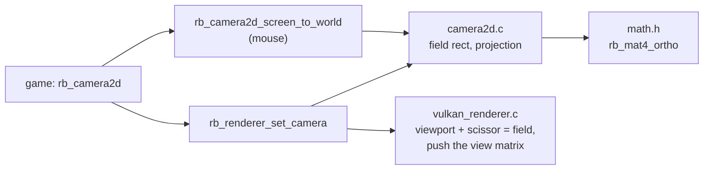

# Math & 2D camera

| | |
|---|---|
| **Status** | In progress |
| **Since** | v0.2.0 (2026-11-23) |
| **Updated** | v0.2.0 (2026-11-24) |
| **Code** | `engine/include/reborn/math.h`, `engine/include/reborn/camera2d.h`, `engine/src/renderer/camera2d.c`, `engine/src/renderer/camera2d_internal.h` |
| **ADRs** | [0016](../adr/0016-math-and-2d-camera.md) |

## Summary
Games lay out their world in units of their own choice, independent of the window's resolution.
A 2D camera says which area of the world to show; the renderer fits it into the window with bars
where the aspect differs, and the game converts mouse positions back into world units.

## Spec
- **Math** (`reborn/math.h`, header-only, `static inline`): `rb_vec2` (add, sub, scale,
  component-wise mul), `rb_rect` (top-left corner and size), `rb_mat4` column-major (element row r, column c at `m[c * 4 + r]`, as GLSL
  reads it), `rb_mat4_ortho(left, right, top, bottom)` mapping that rectangle to Vulkan's -1..1, y
  down, z 0. Nothing else yet: multiplication, rotation and the rest arrive with their first user.
- **Camera** (`reborn/camera2d.h`): `rb_camera2d {center, size, zoom}`, made with
  `rb_camera2d_make(center, size)` (zoom 1). `size` is the design area, always shown whole and as
  large as the window allows; `zoom` shows `size / zoom` around `center`. Size or zoom not positive:
  `RB_ASSERT`. World y points down, like window pixels.
- **Field:** the largest rectangle with the aspect of `size` that fits the window, centered, in
  whole pixels; the rest are bars. 1280x1024 with a 16x9 size: 1280x720 at y 152.
- **Renderer:** `rb_renderer_set_camera(renderer, &camera)` inside `render`: the draws that follow
  are in world units, clipped to the field (viewport and scissor); the bars keep whatever is there,
  the clear color unless the game drew on them. `NULL`: window pixels again (the HUD). Each frame
  begins in pixels. The camera is copied: changes need another call.
- **Mouse:** `rb_camera2d_screen_to_world(&camera, target, point)` with the window's pixel size
  (`rb_window_get_size`) and a point in window pixels (`rb_mouse_position`); the same field as the
  renderer, so a click lands where it looks. Points on the bars map outside the area shown; a
  target with no pixels returns `center`.
- Not yet: world-to-screen, camera rotation, a bars color of their own.

## Design


- `camera2d.c` is pure CPU math outside `vulkan/`: any backend uses it, and the mouse conversion
  shares the field computation with the renderer.
- The view matrix is the first 64 bytes of the push constants, pushed when the space changes; each
  quad pushes only its part after it (push constants persist across draws). In pixels the view
  is `rb_mat4_ortho(0, width, 0, height)`.
- A field squeezed to no pixels (extreme aspect) keeps a 1-pixel viewport, since a viewport must
  not be empty, and an empty scissor: nothing is drawn.

## API
```c
rb_camera2d camera = rb_camera2d_make((rb_vec2){8.0f, 4.5f}, (rb_vec2){16.0f, 9.0f});

static void game_render(void *state, rb_app *app, f64 alpha) {
    rb_renderer *renderer = rb_app_renderer(app);
    rb_renderer_set_camera(renderer, &camera);               /* world units */
    rb_renderer_draw_quad(renderer, 0, 0, 16, 9, field_color); /* the field's background */
    rb_renderer_draw_quad(renderer, 7.5f, 4.0f, 1, 1, red);    /* a square in the middle */
    rb_renderer_set_camera(renderer, NULL);                  /* window pixels: the HUD */
    rb_renderer_draw_quad(renderer, 16, 16, 200, 24, white);
}

/* A click, in world units. */
rb_window_size size = rb_window_get_size(platform, window);
rb_vec2 world = rb_camera2d_screen_to_world(&camera,
                                            (rb_vec2){(f32)size.pixel_width, (f32)size.pixel_height},
                                            (rb_vec2){(f32)ev->button.x, (f32)ev->button.y});
```

## Decisions
- `rb_vec2` + `rb_mat4` (ADR 0016, A1), by value (B1), header-only (C1), column-major (D1).
- The whole design area always visible, with bars (E2); world y down (F1).
- A current camera, `NULL` for pixels (G1); camera in its own header, code next to the renderer
  but outside the backend (H1).
- `center` + `size` + `zoom`, built by `rb_camera2d_make` (I2); the renderer only clips, the bars
  keep the clear color (J1).

## Future work
- World-to-screen, when a game places HUD elements over world objects.
- Camera rotation and matrix multiplication, with rotated quads (Orbit).
- A bars color of their own, if the clear color is not enough.

## History
| Version | Date | Change |
|---|---|---|
| v0.2.0 | 2026-11-23 | First version: `rb_vec2`, `rb_mat4`, ortho; `rb_camera2d` with letterbox, zoom, screen-to-world; `rb_renderer_set_camera` |
| v0.2.0 | 2026-11-24 | `rb_rect`, for texture regions (ADR 0018) |
