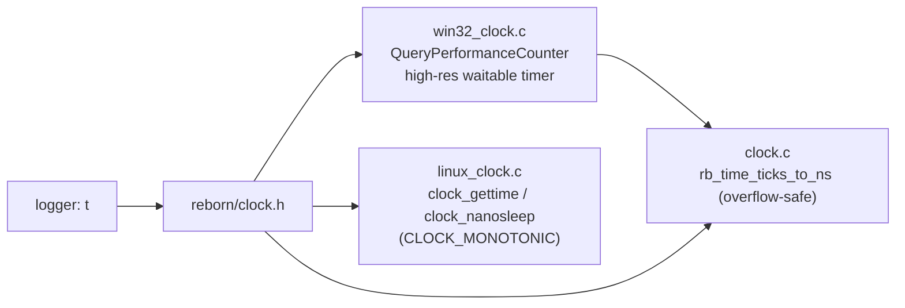

# Clock & sleep

| | |
|---|---|
| **Status** | Stable |
| **Since** | v0.1.0 (2026-11-16) |
| **Updated** | v0.1.0 (2026-11-16) |
| **Code** | `engine/include/reborn/clock.h`, `engine/src/platform/clock.c`, `engine/src/platform/*/…_clock.c` |
| **ADRs** | [0009](../adr/0009-monotonic-clock-and-sleep.md) |

## Summary
A monotonic, high-resolution clock in nanoseconds and a sleep precise to about a millisecond on
both platforms. Base of frame timing (game loop) and of the logger's `t`.

## Spec
- `rb_time_now()`: nanoseconds since an OS-defined origin (usually boot). Never goes back.
  Resolution below a microsecond. Only differences between readings mean something.
- `rb_time_sleep(ns)`: blocks for at least `ns`; 0 returns at once. Typical overshoot: ~0.5 ms on
  Windows, ~0.1 ms on Linux, more on a loaded machine.
- `rb_time_to_seconds(ns)`: `f64` seconds, nanoseconds kept for long durations.
- Stateless: usable before any startup. Thread-safe (no shared state).
- Not a wall clock: for dates use the log anchor / `ts` (ADR 0008).
- Does not specify whether time spent in system suspend is counted.

## Design


## API
```c
u64 start = rb_time_now();
rb_time_sleep(2 * RB_NS_PER_MS);
f64 dt = rb_time_to_seconds(rb_time_now() - start); /* >= 0.002 */
```

## Decisions
- QPC / `CLOCK_MONOTONIC`, `u64` nanoseconds, stateless, OS origin (ADR 0009).
- Windows sleep on a high-resolution waitable timer, not `timeBeginPeriod` (ADR 0009, D3).
- Tick conversion split into seconds and remainder: no overflow after 30 minutes of uptime.

## Future work
- Spin for the last fraction of a frame if the game loop needs tighter pacing (ADR 0009, D4).
- Reuse the Windows timer across sleeps if its creation shows in the profiler.

## History
| Version | Date | Change |
|---|---|---|
| v0.1.0 | 2026-11-16 | First version: `rb_time_now`, `rb_time_sleep`, `rb_time_to_seconds` |
