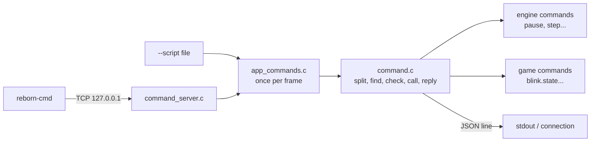

# Commands

| | |
|---|---|
| **Status** | In progress |
| **Since** | v0.2.0 (2026-11-24) |
| **Updated** | v0.2.0 (2026-11-24) |
| **Code** | `engine/include/reborn/command.h`, `engine/src/command/`, `engine/src/app/app_commands.c`, `engine/src/platform/*/…_socket.c`, `tools/reborn-cmd/` |
| **ADRs** | [0022](../adr/0022-command-system.md) |

## Summary
Named actions with arguments (`step 10`, `blink.state`), each answering with one JSON line. They
reach a running game from a script given at startup or from a local connection, so an agent or a
script can pause a game, advance it step by step and read its state, on Windows and Linux alike.

## Spec
- **Sources:** `--script <file>` runs the file's lines, replies on stdout (the log is on stderr);
  `--listen <port>` accepts lines on `127.0.0.1:<port>`, one client at a time, replies on the
  connection. `--listen 0` takes any free port (logged). Both can be given together.
- **When:** once per frame, before its steps, on the main thread. A script runs its lines until a
  `wait`, its end or a quit; the server runs every complete line received. At the script's end the
  game keeps running.
- **Line:** words split by spaces and tabs, `"..."` groups words (`\"` and `\\` inside), a word
  starting with `#` starts a comment. Empty lines and comments get no reply. At most 1023 bytes
  and 16 words; a line ends at `\n` (a `\r` before it is dropped).
- **Reply:** `{"id":N,"ok":true,"from":"socket","line":"...","result":{...}}` or `"ok":false` with
  `"error":"..."`. `id` and `ok` always come first. `from` is `socket` or `script:<line>`. At most
  16 KiB. Floats in the fewest digits that read back the same; NaN and infinities as `null`.
- **Pause:** owned by the engine. Paused, each frame pumps the window and delivers events to
  `on_event`, runs no `update`, and still renders. The step clock drops the paused time.
- **Engine commands:** `help [name]`, `status`, `pause`, `resume`, `step [count]` (pauses, runs
  1..100000 steps at once, each with a fresh frame arena), `quit`, `wait <steps>` (scripts only,
  refused while paused).
- **Game commands:** registered in `init` with `rb_app_register_command`; names lowercase with
  the game's prefix (`blink.state`). At most 64 commands in all. Each game's README lists its
  own; the main README lists the engine's. The sandbox has `sandbox.clear [<r> <g> <b>]`.
- **Client:** `reborn-cmd <port> <line>...` prints each reply; exit code 0 all succeeded, 1 one
  failed, 2 no game or no reply within 60 s.
- **Not yet:** input injection and screenshots (the next steps), the in-game console, console
  variables, several clients at once, a hash map for the names.

## Design

- `command.c`: splitting, the registry (a fixed table, linear search), replies written through the
  logger's `rb_text_writer`. No app, file or socket: tests feed it strings.
- `command_script.c`: the file read whole into the persistent arena, then line by line.
- `command_server.c`: non-blocking listener and client, a line buffer; never blocks the loop.
- `platform_socket.h`: Winsock / POSIX sockets behind one interface, shared with `reborn-cmd`.

## API
```c
static void cmd_score(void *state, rb_app *app, const rb_command_args *args,
                      rb_command_reply *reply) {
    my_game *game = state;
    rb_command_reply_u64(reply, "score", game->score);
}

static bool game_init(void *state, rb_app *app) {
    return rb_app_register_command(app, &(rb_command_desc){
        .name = "game.score", .summary = "the current score", .fn = cmd_score});
}

int main(int argc, char **argv) {
    return rb_app_run(&game, argc, argv);
}
```
```sh
./build/debug/bin/blink --listen 7777 &
./build/debug/bin/reborn-cmd 7777 pause "blink.state" "step 10" "blink.state"
./build/debug/bin/blink --script test.txt > replies.jsonl
```
Arguments: `rb_command_arg_u32` / `_u64` / `_f32` (write the error and return false). Reply:
`rb_command_reply_bool` / `_i64` / `_u64` / `_f32` / `_f64` / `_str`, `_begin_object` /
`_end_object`, `_error`. Pause state: `rb_app_is_paused`, `rb_app_step_index`.

## Decisions
- TCP on loopback polled once per frame, no thread; a client executable (ADR 0022, A1).
- Command-line options passed through `rb_app_run` (B1); text lines in, JSON lines out (C1).
- `argc`/`argv`-style arguments with parsing helpers (D1); a typed reply writer (E1).
- Fixed table (F1); commands at the start of the frame, pause in the engine (G1).

## Future work
- Input injection, screenshots, then golden images and unattended runs on top of scripts.
- The in-game console with the debug UI; console variables; state inspection commands.
- A hash map for the registry (v0.3.0); several clients at once if agents need it.

## History
| Version | Date | Change |
|---|---|---|
| v0.2.0 | 2026-11-24 | First version: registry, script, local server, `reborn-cmd`, pause and step; Blink's and the sandbox's commands |
