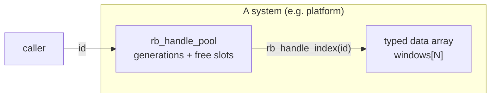

# Containers

| | |
|---|---|
| **Status** | In progress |
| **Since** | v0.1.0 (2026-11-15) |
| **Updated** | v0.1.0 (2026-11-15) |
| **Code** | `engine/src/containers/` |
| **ADRs** | [0007](../adr/0007-index-only-containers.md) |

## Summary
Reusable data structures for engine systems. The first two are *index-only*: they manage slot
indices and never touch the elements, so the caller keeps a typed array and no generics are needed.

## Spec
- **Handle pool** (`handle_pool.h`): `u32` ids = 12-bit generation + 20-bit index.
  - Up to 2^20 slots; slots handed out from 0 upwards, freed slots reused last-in first-out.
  - Id 0 is never valid; stale ids (freed, double-freed, reused slot) are rejected.
  - A slot is retired after 4 095 reuses instead of wrapping its generation.
- **Ring** (`ring.h`): FIFO of indices, any capacity (0 = always full and empty). The newest
  element can be read without popping it, so a producer can merge into it (platform resize events).
- Both: no allocation, the caller provides the memory. Not thread-safe.
- Internal to the engine: not part of the public API (yet).

## Design

The same pattern holds for the ring: `rb_ring` decides the slot, `events[slot]` holds the data.

## API
```c
rb_handle_pool pool;
u16 generations[8];
u32 free_slots[8];
rb_handle_pool_init(&pool, generations, free_slots, 8);

u32 id = rb_handle_pool_alloc(&pool);              /* RB_HANDLE_INVALID if full */
if (rb_handle_pool_valid(&pool, id)) {
    windows[rb_handle_index(id)].width = 1280;
}
rb_handle_pool_free(&pool, id);                    /* id is now stale */
```
```c
rb_ring  ring;
rb_event events[256];
rb_ring_init(&ring, 256);

u32 i;
if (rb_ring_push_index(&ring, &i)) events[i] = ev;
while (rb_ring_pop_index(&ring, &i)) handle(&events[i]);
```

## Decisions
- Index-only containers instead of `void *` or macro-generated code (ADR 0007).
- 20/12 bit split and slot retirement (ADR 0007).
- Free slots are a plain stack inside the pool, not a separate container.
- Ring stores a count instead of a tail index, so full and empty are distinguishable.

## Future work
- Dynamic array, hash map: own memory, need an allocator (ADR 0010) and their own ADR.

## History
| Version | Date | Change |
|---|---|---|
| v0.1.0 | 2026-11-15 | Handle pool and ring buffer |
| v0.1.0 | 2026-11-15 | `rb_ring_newest_index`, used to merge consecutive resize events |
