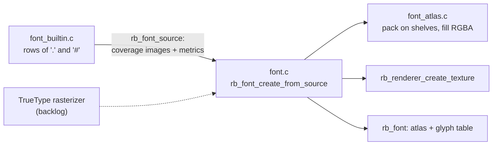

# Fonts

| | |
|---|---|
| **Status** | In progress |
| **Since** | v0.2.0 (2026-11-24) |
| **Updated** | v0.2.0 (2026-11-24) |
| **Code** | `engine/include/reborn/font.h`, `engine/src/text/` |
| **ADRs** | [0018](../adr/0018-bitmap-font-and-glyph-atlas.md) |

## Summary
Text on screen is one textured quad per character. A font keeps every character's image (its
glyph) in one texture, the atlas, and the metrics that place them along a line. The engine ships
its own 8x8 bitmap font; the code is split so that a TrueType source can be added without touching
the rest.

## Spec
- **Builtin font:** `rb_font_create_builtin(allocator, renderer)`: 8x8 cells drawn for the engine,
  ASCII 32–126 plus a missing glyph (an empty box) for any other codepoint. Ascent 7, descent 1,
  line gap 2, advance 8. Nearest filtering: sharp at integer scales (x2, x3...), uneven at others.
- **Glyph:** `rb_font_get_glyph(font, codepoint)` → `{source, offset, advance}`: `source` is the
  image's rectangle in the atlas (empty for a space), `offset` goes from the pen on the baseline to
  the image's top-left corner (y < 0 above), `advance` moves the pen. All in pixels at the font's
  own size, y down.
- **Metrics:** `rb_font_get_metrics` → `{ascent, descent, line_gap}`; baselines are
  `ascent + descent + line_gap` apart.
- **Atlas:** `rb_font_get_atlas` → the `rb_texture` to draw glyphs from with
  `rb_renderer_draw_texture_region`. White RGBA, coverage in alpha: the tint colors the text. One
  pixel of transparent padding between glyphs; the builtin atlas is 128x62.
- **Lifetime:** created at any time (inside `render` too); `rb_font_destroy` outside `render` and
  before the renderer's shutdown, since it destroys the atlas texture. NULL is ignored.
- **Memory:** the font and the atlas's pixels (freed after the upload) come from the caller's
  allocator, tag `RB_MEMORY_TAG_TEXT`.
- Strings (measuring, alignment, lines, UTF-8 decoding) are drawn by the [text](text.md) layer.
- Not yet: glyphs beyond ASCII, other sizes, TrueType, kerning.

## Design


- **Source:** produces per glyph a coverage image (one byte per pixel, 0–255) and its metrics, plus
  the font's metrics, atlas width and filter (`text/font_internal.h`). The builtin source decodes
  `#` to 255; a glyph without ink (the space) gets no image.
- **Packer** (`text/font_atlas.h`): images left to right in table order, a new row when the next
  does not fit, rows as tall as their tallest image, 1 pixel of padding between neighbors so a
  linear filter never reads the next glyph. Pure functions, tested without a GPU.
- **Font:** packs, fills the RGBA pixels (white under transparent pixels too, so linear filtering
  never darkens colored edges), uploads, keeps the glyph table. A new source only fills an
  `rb_font_source`.
- **Lookup:** a fixed table of 96 entries (missing + ASCII), reached only through
  `rb_font_get_glyph`, so more glyphs change the storage without touching callers.
- **Internal struct:** `struct rb_font` is defined in `text/font_internal.h`, with
  `rb_font_set_glyphs`, so tests can build a font without a GPU (ADR 0021).

## API
```c
rb_font *font = rb_font_create_builtin(rb_app_allocator(app), rb_app_renderer(app));

/* Strings: through reborn/text.h (text.md). */
rb_text_style style = {.font = font, .size = 24, .color = white};
rb_text_draw(renderer, 32, 32, &style, "Hi");

/* One glyph by hand, three times larger, pen on the baseline at (32, 53). */
rb_glyph glyph = rb_font_get_glyph(font, 'H');
rb_renderer_draw_texture_region(renderer, 32 + glyph.offset.x * 3, 53 + glyph.offset.y * 3,
                                glyph.source.width * 3, glyph.source.height * 3,
                                rb_font_get_atlas(font), glyph.source, white);

rb_font_destroy(font);   /* in shutdown, not in render */
```

## Decisions
- Bitmap font now, own TrueType rasterizer later (ADR 0018); a source rectangle per textured draw
  in texture pixels (A1).
- General per-glyph metrics even for a monospace font (B1); a generic shelf packer (C1); a fixed
  ASCII table behind a lookup function (D1).
- 8x8 glyphs drawn for the engine, in the source as rows of `.` and `#` (E1); RGBA atlas (F1);
  opaque `rb_font` from an allocator (G1); `engine/src/text/` (H1).

## Future work
- TrueType source: parser and rasterizer of our own, for text at several sizes.
- Glyphs beyond ASCII: a codepoint → glyph map behind `rb_font_get_glyph` (strings are already
  decoded as UTF-8 by the text layer).
- Packing sorted by height, single-channel atlases (ADR 0017, F3), kerning.

## History
| Version | Date | Change |
|---|---|---|
| v0.2.0 | 2026-11-24 | First version: builtin 8x8 font, glyph atlas, `rb_font` API |
| v0.2.0 | 2026-11-24 | `struct rb_font` in the internal header, `rb_font_set_glyphs` (ADR 0021) |
