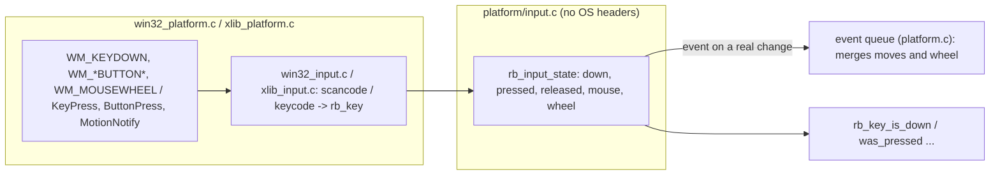

# Keyboard & mouse input

| | |
|---|---|
| **Status** | In progress |
| **Since** | v0.1.0 (2026-11-16) |
| **Updated** | v0.2.0 (2026-11-26) |
| **Code** | `engine/include/reborn/input.h`, `engine/include/reborn/platform.h`, `engine/src/platform/input.c`, `engine/src/platform/*/` `*_input.c`, `engine/src/app/input_queue.c`, `engine/src/app/app_input.c` |
| **ADRs** | [0006](../adr/0006-platform-layer.md) (F1, O–U), [0023](../adr/0023-input-injection.md) |

## Summary
Keys by physical position and the mouse, as events in the platform queue and as a per-pump state
for game code. Same behaviour on Win32 and Xlib.

## Spec
- **Keys** are positions (`rb_key`, USB HID usage values below 256), named after the US QWERTY
  label: `RB_KEY_W` stays where W is on QWERTY on every layout. Keys the enum does not name (media,
  Japanese, Korean) send nothing. ISO keyboards: the key left of Enter is `RB_KEY_BACKSLASH`, the
  key between Left Shift and Z is `RB_KEY_NON_US_BACKSLASH`. `rb_key_name` gives the enum's name,
  for logs.
- **Events:** `KEY_PRESSED` / `KEY_RELEASED` (`ev.key`: key, modifiers, `repeat`),
  `MOUSE_BUTTON_PRESSED` / `RELEASED` (`ev.button`: left, right, middle, X1, X2; position;
  modifiers), `MOUSE_MOVED` (`ev.move`), `MOUSE_WHEEL` (`ev.wheel`). Each names its window.
- **Auto-repeat** arrives as `KEY_PRESSED` with `repeat` set; a release of a key pressed before the
  window had focus sends nothing.
- **Modifiers** (`RB_KEY_MOD_SHIFT`, `CTRL`, `ALT`, `SUPER`): either key of the pair, as after the
  event (a Shift press includes SHIFT).
- **Mouse position:** client area pixels (what the renderer draws), origin top left. While a
  button is held the window keeps the mouse, so positions may be negative or beyond the size.
  Consecutive moves of a window merge in the queue; an unchanged position sends nothing.
- **Wheel** in notches (`f32`), positive up and right; consecutive wheel events of a window are
  summed in the queue.
- **Focus lost** with keys or buttons held: a release for each, to the window losing focus, before
  `FOCUS_LOST`. On X11 a keyboard grab (window manager's Alt+Tab) releases them too. Destroying
  the focused window clears the state without events.
- **State queries** as of the last pump (one keyboard, one mouse): `rb_key_is_down`,
  `rb_key_was_pressed`, `rb_key_was_released`, `rb_key_mods`, the same three for mouse buttons,
  `rb_mouse_get_window`, `rb_mouse_get_position`, `rb_mouse_get_wheel` (sum of the pump). A press
  and release within one pump reports both edges. Out-of-range values give false.
- **Win32:** AltGr's fake Left Ctrl is dropped; a Shift stuck by releasing one of two held Shifts
  is released after the pump; Print Screen (release only) gets a press first; Alt or F10 alone do
  not enter the window menu mode (Alt+Space opens no system menu). Alt+F4 still closes.
- **Linux:** keycodes are read as evdev + 8 (Xorg, XWayland, Xvfb, WSLg); detectable auto-repeat
  is requested at startup (a warning if the server lacks it).
- **Injected input** (ADR 0023): the `input.*` commands ([commands.md](commands.md)) queue keys,
  buttons, moves and wheel for the next step, which applies them right after its pump: the same
  state changes and events as real input, on every platform, without a display. A paused frame
  applies nothing. Injected keys and buttons are marked while down: focus loss, an X keyboard grab
  and Win32's stuck-Shift fix release only real ones; a real press, repeat or release of a marked
  key takes it over.
- **Real input off** (`input.real off`): the backends' keys, buttons, moves and wheel are dropped;
  window events and the OS's shortcuts (Alt+F4) still work. Turning it off first releases what
  the devices hold. `rb_app_real_input` tells a game.
- Not yet: text input, relative mouse motion and cursor lock, key labels of the current layout,
  mouse enter/leave, cursor shape, gamepads.

## Design

Injected input enters at the common code, next to the backends' reports
(`rb_platform_common_inject_*`), from a queue the application applies after each step's pump.

Backends map OS codes to `rb_key` / `rb_mouse_button` and report them; the common code keeps the
state, decides repeats and modifiers, and queues the events, so both backends behave the same and
the logic is unit-tested without windows. `rb_platform_pump` clears the edges and the wheel sum
first: the pump is the frame. The application layer pumps once per update step ([app.md](app.md)),
so a game's `update` sees each press exactly once. The mapping tables include no OS header, so they are tested on their
own OS.

## API
```c
rb_platform_pump(platform);
rb_event ev;
while (rb_platform_poll_event(platform, &ev)) {
    if (ev.type == RB_EVENT_KEY_PRESSED && !ev.key.repeat && ev.key.key == RB_KEY_S &&
        (ev.key.mods & RB_KEY_MOD_CTRL)) {
        save();
    }
}
if (rb_key_is_down(platform, RB_KEY_W)) move_forward();
if (rb_key_was_pressed(platform, RB_KEY_SPACE)) jump();
if (rb_mouse_button_was_pressed(platform, RB_MOUSE_BUTTON_LEFT)) {
    rb_mouse_position p = rb_mouse_get_position(platform); /* pixels */
}
```

## Decisions
- Physical keys, HID values, US QWERTY names (ADR 0006, F1, O1).
- Linux keycodes through a fixed evdev table; XKB names if a server ever differs (P1).
- Repeats flagged, modifiers in events, pixels, releases on focus loss, edges per pump (Q1–U1).
- Repeats and modifiers come from the engine's own key state, not the OS: identical on both
  backends and testable.
- Mouse capture while a button is held (`SetCapture`; implicit grab on X11).
- Input code in its own files (`input.c`, `*_input.c`) rather than growing `platform.c` and the
  backends.
- Injection at the common code, applied after the step's pump; injected keys marked; real input
  can be turned off (ADR 0023, A1, B1, F2).

## Future work
- Text input events (Unicode), separate from keys.
- Relative mouse motion with a locked, hidden cursor (raw input / XInput2).
- Key labels of the current layout for prompts.
- Mouse enter/leave, cursor shape, gamepads.
- Action mapping (bindings) once the game lifecycle exists.
- Recorded input played back through the injection queue, with real input off (record and replay).

## History
| Version | Date | Change |
|---|---|---|
| v0.1.0 | 2026-11-16 | First version: keys, mouse buttons, moves, wheel; state queries; Win32 and Xlib |
| v0.1.0 | 2026-11-16 | Under the application layer the pump, hence the edges, follow the update step |
| v0.2.0 | 2026-11-26 | Injected input (`input.*` commands), marked while held; real input can be turned off |
