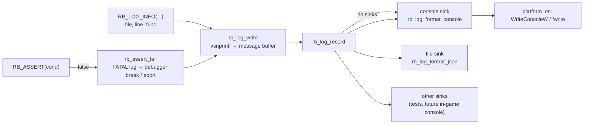

# Logging & asserts

| | |
|---|---|
| **Status** | Stable |
| **Since** | v0.1.0 (2026-11-15) |
| **Updated** | v0.1.0 (2026-11-16) |
| **Code** | `engine/include/reborn/log.h`, `engine/include/reborn/assert.h`, `engine/src/core/log.c`, `engine/src/core/assert.c`, `engine/src/platform/*/…_os.c` |
| **ADRs** | [0008](../adr/0008-logging-and-asserts.md), [0009](../adr/0009-monotonic-clock-and-sleep.md) |

## Summary
One global logger with six levels, a colored console for people and a JSON lines file for LLMs
and scripts. `RB_ASSERT` stops on broken invariants in debug builds.

## Spec
- Levels TRACE, DEBUG, INFO, WARN, ERROR, FATAL. FATAL does not stop the program.
- Works at any time: with no sink registered (before `rb_log_startup`, after `rb_log_shutdown`)
  records go to the console.
- Compile-time minimum: TRACE in debug, INFO in release (`RB_LOG_MIN_LEVEL`). Removed calls do not
  evaluate their arguments.
- Up to 8 sinks, each with its own minimum level, called in registration order.
- Messages up to 2047 bytes; longer ones are cut at a UTF-8 boundary and end with `...`.
- Console: stderr, `time LEVEL message`, plus `(file:line)` from WARN up. ANSI colors only on a
  terminal, never with `NO_COLOR` or `TERM=dumb`. UTF-8 shows correctly on the Windows console.
- File: JSON lines, overwritten at startup, flushed after every line. Always valid JSON.
- Time: `t` = seconds since the logger's first use (console and JSON), on the monotonic clock
  (`rb_time_now`): it never jumps. Startup logs the local date and time of `t = 0` (ISO 8601 with
  UTC offset); JSON lines also carry `ts`, milliseconds since 1970 UTC on the wall clock, which
  follows changes of the system time.
- `file` is relative to the repository root (when built by its CMake) and uses `/`.
- `RB_ASSERT` / `RB_ASSERT_MSG`: on in debug (`RB_ASSERT_ENABLED`). Failure: FATAL log, breakpoint
  if a debugger is attached, else `abort()`. Disabled conditions are not evaluated. Only for bugs
  in the calling code (required pointers at public entry points, invariants), never for input or
  environment failures. Used today by the platform API on its pointer parameters.
- Not thread-safe. A sink that logs is ignored. Sinks must not be added or removed from inside a
  sink.

## Design


## API
```c
rb_log_startup(&(rb_log_config){
    .console_level = RB_LOG_LEVEL_INFO,
    .file_path = "reborn.log.jsonl",
    .file_level = RB_LOG_LEVEL_TRACE,
});
RB_LOG_INFO("Window %ux%u", width, height);
RB_ASSERT_MSG(index < count, "index %u of %u", index, count);
rb_log_shutdown();

/* Custom output */
static void my_sink(const rb_log_record *r, void *user) { /* r->message, r->level... */ }
rb_log_add_sink(my_sink, my_data, RB_LOG_LEVEL_WARN);
rb_log_remove_sink(my_sink, my_data);
```
Console and JSON lines (the first line is the clock anchor written by startup):
```
    0.009 INFO  Log clock: t = 0 at 2026-11-15T20:07:18.059+01:00
    0.100 INFO  Window 0x00100000 created: 1280x720 logical, 1600x900 pixels at 120 DPI (125%)
```
```json
{"t":0.008981,"ts":1794769638068,"level":"INFO","file":"engine/src/core/log.c","line":383,"func":"log_announce_clock","msg":"Log clock: t = 0 at 2026-11-15T20:07:18.059+01:00"}
{"t":0.099951,"ts":1794769638159,"level":"INFO","file":"engine/src/platform/win32/win32_platform.c","line":261,"func":"rb_window_create","msg":"Window 0x00100000 created: 1280x720 logical, 1600x900 pixels at 120 DPI (125%)"}
```

## Decisions
- Global state, printf-style macros, sinks, JSON lines file, ANSI colors, compile-time + runtime
  levels, debug-only asserts (ADR 0008).
- `t` on the monotonic clock, `ts` and the anchor on the wall clock (ADR 0008, H; ADR 0009).
- Absolute time as one anchor line plus `ts` in JSON, not a date on every console line (ADR 0008).
- `WriteConsoleW` for the Windows console instead of changing its code page (ADR 0008).
- `-fmacro-prefix-map` for relative `__FILE__`; `_CRT_SECURE_NO_WARNINGS` on Windows (ADR 0008).

## Future work
- Replaceable assert handler, to test failing asserts.
- Thread safety (with threading).
- Categories with their own level; in-memory history for an in-game console / LLM debug API.

## History
| Version | Date | Change |
|---|---|---|
| v0.1.0 | 2026-11-15 | First version: levels, sinks, console, JSON lines file, `RB_ASSERT` |
| v0.1.0 | 2026-11-16 | `t` measured on the monotonic clock (ADR 0009) |
