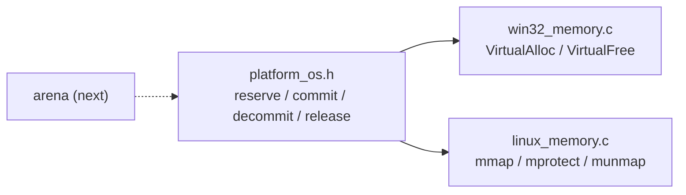

# Memory

| | |
|---|---|
| **Status** | In progress |
| **Since** | v0.1.0 (2026-11-16) |
| **Updated** | v0.1.0 (2026-11-16) |
| **Code** | `engine/src/platform/platform_os.h`, `engine/src/platform/*/…_memory.c` |
| **ADRs** | [0010](../adr/0010-memory-allocation.md) |

## Summary
Where engine memory comes from. Today: virtual memory from the OS, reserved and committed as
separate steps. Arenas, the allocator interface and ASan support follow (roadmap §6).

## Spec
- **Reserve** claims an address range: no RAM, no commit charge. Start aligned to
  `rb_platform_reserve_granularity()` (64 KiB on Windows, a page on Linux).
- **Commit** makes pages of a reserved range readable and writable, zero on first touch. It is
  where out-of-memory is reported (`false`, logged): Windows and Linux both charge the commit limit
  there, not at a later write. Committing committed pages keeps their contents.
- **Decommit** returns the pages and their charge; they stay reserved and read as zero once
  committed again. **Release** frees the whole reservation (`ptr` and `size` as reserved).
- Touching a reserved page that is not committed crashes.
- Sizes and pointers are whole pages (`RB_ASSERT`); callers round.
- Internal to the engine, stateless, usable before any startup. Not thread-safe to log failures
  on Linux (`strerror`).
- Not yet: large pages, guard pages, memory protection changes (read-only, executable).

## Design


| Step | Windows | Linux |
|---|---|---|
| Reserve | `VirtualAlloc(MEM_RESERVE, PAGE_NOACCESS)` | `mmap(PROT_NONE)` |
| Commit | `VirtualAlloc(MEM_COMMIT, PAGE_READWRITE)` | `mprotect(PROT_READ \| PROT_WRITE)` |
| Decommit | `VirtualFree(MEM_DECOMMIT)` | `mmap(MAP_FIXED, PROT_NONE)` over the range |
| Release | `VirtualFree(MEM_RELEASE)` | `munmap` |

## API
```c
usize page = rb_platform_page_size();
u8   *base = rb_platform_memory_reserve(RB_GIB(64)); /* addresses only */
if (base != NULL && rb_platform_memory_commit(base, 16 * page)) {
    base[0] = 1; /* first 64 KiB usable */
}
rb_platform_memory_release(base, RB_GIB(64));
```

## Decisions
- Reserve and commit as separate steps, so arenas grow in place and never move (ADR 0010, A1, B2).
- Linux reserves without `MAP_NORESERVE`: the commit charge is taken by `mprotect`, so commit can
  fail cleanly as on Windows (measured: reserving 64 GiB charges 0, committing 1 GiB charges 1 GiB).
- Linux decommits by mapping a fresh `PROT_NONE` range over it: it drops both the pages and the
  charge in one call (`mprotect` keeps both, `madvise(MADV_DONTNEED)` keeps the charge).
- Win32 `GetLastError` logging moved to `win32_error.c`, shared by the backend files.

## Future work
- Arena, allocator interface, heap allocator, ASan poisoning, failing test allocator (ADR 0010).
- Tracking by tag and leak report (roadmap §6, after §4).
- Chained arena blocks when a trigger in `TODO.md` shows up (ADR 0010, B3).

## History
| Version | Date | Change |
|---|---|---|
| v0.1.0 | 2026-11-16 | Virtual memory: reserve, commit, decommit, release |
