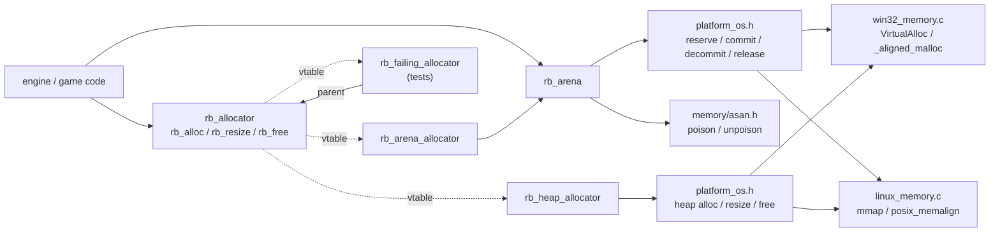

# Memory

| | |
|---|---|
| **Status** | Stable |
| **Since** | v0.1.0 (2026-11-16) |
| **Updated** | v0.1.0 (2026-11-16) |
| **Code** | `engine/include/reborn/memory.h`, `engine/src/memory/`, `engine/src/platform/platform_os.h`, `engine/src/platform/*/…_memory.c`, `tests/support/failing_allocator.*` |
| **ADRs** | [0010](../adr/0010-memory-allocation.md), [0012](../adr/0012-allocation-tracking.md) |

## Summary
Where engine memory comes from: virtual memory from the OS, reserved and committed as separate
steps; arenas on top of it that grow in place and free everything at once; the C runtime's aligned
heap for objects freed one at a time. Code that must not care where its memory comes from takes an
`rb_allocator`, an interface that an arena, the heap or a test allocator plugs into. Every
allocation through it names a tag (the subsystem it belongs to) and is counted under it, so leaks
and peaks show up per subsystem at the end of the run.

## Spec
**Allocator interface** (public, `reborn/memory.h`)
- `rb_allocator` is `{ctx, vtable}`, passed and stored by value; the state behind `ctx` must
  outlive every copy. The vtable has `alloc` (uninitialized), `resize` (keeps min(old, new) bytes,
  may move) and `free`.
- Sized: the caller passes back the size and alignment it allocated with (or last resized to).
- Helpers: `rb_alloc` zeroes, `rb_resize` zeroes the grown bytes; `_uninit` variants skip it.
  `rb_alloc_array` / `RB_ALLOC_ARRAY` fail on a count that overflows. `align` is a power of two
  (asserted).
- Failure returns `NULL`, logged by the allocator; a failed resize leaves the old block valid.
- Freeing `NULL` does nothing; resizing `NULL` (old size 0) allocates. Size 0 is an ordinary block:
  a valid pointer, not to be dereferenced, freed like any other.

**Tracking** (public, `reborn/memory.h`; ADR 0012)
- Every helper takes an `rb_memory_tag` as its last argument (`GENERAL` for tools and tests,
  `PLATFORM`, `GAME`), the same in alloc, resize and free; out of range is asserted.
- Counted per tag by the helpers, whichever allocator serves the call: `live_bytes`, `peak_bytes`,
  `live_blocks`, `alloc_count` (a resize of `NULL` included), `free_count`
  (`rb_memory_get_stats`). Failed calls and frees of `NULL` count nothing. Always on.
- A free larger than its tag holds, or with no block left, is asserted (wrong size or tag).
- Allocators never see tags; wrappers (failing allocator) call their parent's vtable, not the
  helpers, so nothing is counted twice.
- A block from `rb_arena_allocator` stays live for its tag until freed, even after the arena is
  reset: code taking an `rb_allocator` frees what it allocates.
- Report (internal, called by the app at the end of the run): one INFO line per tag that
  allocated (`Memory game: peak 1.50 KiB, 3 allocations, 3 frees`), one ERROR line per tag with
  live blocks (`Memory leak (game): 1 block, 512 bytes never freed`). Sizes print exactly when
  round (`64 MiB`), with two decimals otherwise.
- The stats table is global and not thread-safe.

**Arena** (public, `reborn/memory.h`)
- Hands out memory by moving a position forward; frees only everything (`reset`) or back to a saved
  position (temp scopes). Never moves: pointers stay valid until reset, temp end or destroy.
- Over a reservation (`rb_arena_create`): addresses only at first, RAM committed in 64 KiB steps
  as allocations reach it, never past the reservation. Reset keeps it committed.
- Over a caller's buffer (`rb_arena_create_from_buffer`): fixed size, nothing committed or freed.
- Allocations are zeroed (`_uninit` variant skips it), aligned to any power of two by address.
- Failure returns `NULL` and logs: reservation full, OS out of memory, array size overflow.
- Two allocations are not guaranteed adjacent. Not thread-safe.
- `peak`: the highest position reached (red zones included under ASan), never lowered by reset or
  temp end: what the reservation had to hold.
- ASan builds: free memory and a 16-byte red zone before each allocation are poisoned, so an
  overflow into the neighbour, past the last allocation, or a use after reset / temp end is
  reported. Layout differs from normal builds (red zones, 8-byte minimum alignment).
- As an allocator (`rb_arena_allocator`): free gives memory back only for the last block; resize
  shrinks in place, grows in place when the block is the last one and fits, otherwise copies.
  Neither moves the position below an open temp scope's start, so a block allocated before the
  scope is kept, or copied into the scope when it grows (and then dies at the scope's end). Under
  ASan, freed and shrunk bytes are poisoned even when they stay in place.

**Heap allocator** (public, `rb_heap_allocator`)
- The C runtime's heap, any power-of-two alignment (tested up to 64 KiB). Stateless.
- Size 0 takes 1 byte. Failures are logged with size and alignment.

**Failing allocator** (tests only, `tests/support/failing_allocator.h`)
- Wraps a parent allocator and fails its N-th allocation (1-based; 0 never fails). Growing resizes
  count as allocations; shrinking resizes and frees never fail.
- Counters: `allocation_count` (attempts), `failure_count`, `free_count`, `live_bytes`.
- Forwards to the parent's vtable, so the helpers count each allocation once.

**Virtual memory** (internal, `platform/platform_os.h`)
- **Reserve** claims an address range: no RAM, no commit charge. Start aligned to
  `rb_platform_reserve_granularity()` (64 KiB on Windows, a page on Linux).
- **Commit** makes pages of a reserved range readable and writable, zero on first touch. It is
  where out-of-memory is reported (`false`, logged) on both OSes. Committing committed pages keeps
  their contents.
- **Decommit** returns the pages and their charge; they stay reserved and read as zero once
  committed again. **Release** frees the whole reservation (`ptr` and `size` as reserved).
- Touching a reserved page that is not committed crashes. Whole pages only (`RB_ASSERT`).
- Not yet: large pages, guard pages, other protections (read-only, executable).

**Aligned heap** (internal, `platform/platform_os.h`): `rb_platform_heap_alloc` / `_resize` /
`_free`, sizes > 0, `NULL` on failure (not logged: the allocator does it).

## Design


The helpers (`memory/allocator.c`) do the zeroing, the array overflow check, the `NULL` cases and
the counting by tag (`memory/tracking.c`), so each vtable implements only the raw operations.

Arena layout (ASan build; without ASan there are no red zones):

```
base                                   pos          committed               reserved
 | red | A    | red | B         | red | C |  free (poisoned)  |  reserved only (no RAM)  |
```

| Step | Windows | Linux |
|---|---|---|
| Reserve | `VirtualAlloc(MEM_RESERVE, PAGE_NOACCESS)` | `mmap(PROT_NONE)` |
| Commit | `VirtualAlloc(MEM_COMMIT, PAGE_READWRITE)` | `mprotect(PROT_READ \| PROT_WRITE)` |
| Decommit | `VirtualFree(MEM_DECOMMIT)` | `mmap(MAP_FIXED, PROT_NONE)` over the range |
| Release | `VirtualFree(MEM_RELEASE)` | `munmap` |
| Heap alloc | `_aligned_malloc` | `posix_memalign` |
| Heap resize | `_aligned_realloc` | `realloc` (align ≤ 16), else allocate, copy, free |
| Heap free | `_aligned_free` | `free` |

Arena adapter: a block is the last one when it ends at `pos` and starts at least a red zone above
`floor` (the innermost temp scope's start). Popping it moves `pos` to its start minus the red zone,
where `pos` stood before it (or after it, if alignment added padding), so a push of the same size
gets the same address again.

## API
```c
rb_arena frame;
if (!rb_arena_create(&frame, RB_GIB(1))) { /* logged */ }

for (;;) {                                   /* every frame */
    rb_arena_reset(&frame);
    rb_sprite *sprites = RB_ARENA_PUSH_ARRAY(&frame, rb_sprite, count);

    rb_arena_temp temp = rb_arena_temp_begin(&frame);
    char *scratch = rb_arena_push_uninit(&frame, 4096, 1);
    rb_arena_temp_end(temp);                 /* scratch gone, sprites kept */
}
rb_arena_destroy(&frame);

/* Code that does not choose its memory takes an rb_allocator. */
bool names_create(rb_allocator allocator, rb_names *names, u32 capacity) {
    names->items = RB_ALLOC_ARRAY(allocator, rb_name, capacity, RB_MEMORY_TAG_GAME); /* zeroed */
    if (names->items == NULL) {
        return false;                                              /* logged */
    }
    names->capacity = capacity;
    return true;
}
void names_destroy(rb_allocator allocator, rb_names *names) {
    RB_FREE_ARRAY(allocator, names->items, rb_name, names->capacity, RB_MEMORY_TAG_GAME);
}

names_create(rb_heap_allocator(), &names, 64);        /* freed one by one */
names_create(rb_arena_allocator(&frame), &tmp, 64);   /* gone at reset */
```

Tests walk every error path with the failing allocator (`tests/support/failing_allocator.h`):

```c
for (u32 n = 1;; ++n) {
    rb_failing_allocator failing;
    rb_failing_allocator_init(&failing, rb_heap_allocator(), n);   /* fail the n-th */
    if (!names_create(rb_failing_allocator_get(&failing), &names, 64)) {
        RB_EXPECT_EQ_UINT(failing.live_bytes, 0);                   /* nothing leaked */
        continue;
    }
    names_destroy(rb_failing_allocator_get(&failing), &names);
    break;
}
```

## Decisions
- Reserve and commit as separate steps, so arenas grow in place and never move (ADR 0010, A1, B2).
- Arena over a caller's buffer for free: a buffer is an arena already fully committed (B1).
- Zeroed by default, `NULL` and a log on failure, explicit alignment, temp scopes (H1, G1, E1, F1).
- ASan red zones between allocations, not only a poisoned tail (I2). Only committed memory is
  poisoned; destroy unpoisons, because the shadow outlives the range.
- Linux reserves without `MAP_NORESERVE`, so the commit charge is taken (and can fail) at commit as
  on Windows; it decommits by mapping a fresh `PROT_NONE` range, dropping pages and charge at once.
- Allocator = context + vtable by value; alloc / resize / free, all sized (C1, D2). Free also takes
  the alignment, so an allocator may bucket by it.
- Zeroing and `NULL` handling in the helpers, once, not in every allocator. `rb_resize` zeroes grown
  bytes, consistent with zeroed allocations (H1).
- The arena adapter never pops below an open temp scope (`floor`): otherwise freeing a block
  allocated before the scope would make the scope's end assert.
- Heap = the runtime's aligned allocation (J1): `_aligned_*` on Windows, `posix_memalign` on Linux
  (C11 `aligned_alloc` wants the size to be a multiple of the alignment).
- Failing allocator in `tests/support/` (ADR 0004, L1): fails the N-th allocation only; growing
  resizes count.
- Tag passed on every call, counted in a global table by the helpers (ADR 0012, A2): any allocator
  is tracked; generic code takes its tag from its owner. Counters only, no per-block records (B1).
- Arenas keep a high-water mark instead of being tracked by tag: they cannot leak (C1).

## Future work
- A failing allocator mode that fails every allocation from the N-th on (lasting out of memory), if
  error paths need it.
- Decommit above a high-water mark if an arena's peak holds memory for too long.
- Call sites in the leak report (per-block records in debug builds, ADR 0012, B2) if a tag's
  name is not enough to find a leak.
- Atomic or per-thread stats once threads exist.
- Chained arena blocks when a trigger in `TODO.md` shows up (ADR 0010, B3).

## History
| Version | Date | Change |
|---|---|---|
| v0.1.0 | 2026-11-16 | Virtual memory: reserve, commit, decommit, release |
| v0.1.0 | 2026-11-16 | Arena over a reservation or a buffer, temp scopes, ASan poisoning |
| v0.1.0 | 2026-11-16 | Allocator interface, arena adapter, heap allocator, failing test allocator |
| v0.1.0 | 2026-11-16 | Platform startup takes an allocator; the sandbox uses an engine arena |
| v0.1.0 | 2026-11-16 | Tracking by tag, leak report, arena high-water mark |
