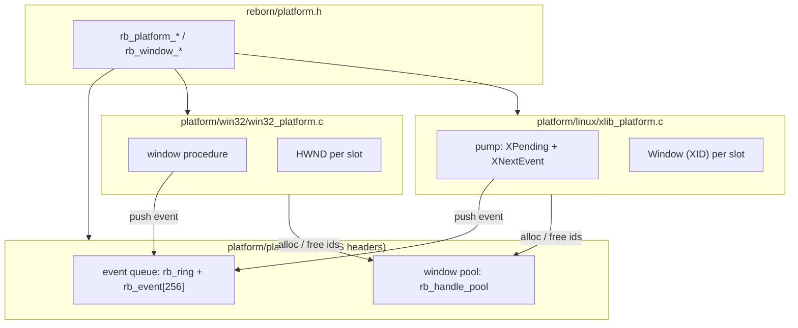

# Platform & windows

| | |
|---|---|
| **Status** | In progress |
| **Since** | v0.1.0 (2026-11-15) |
| **Updated** | v0.1.0 (2026-11-15) |
| **Code** | `engine/include/reborn/platform.h`, `engine/src/platform/` |
| **ADRs** | [0006](../adr/0006-platform-layer.md), [0007](../adr/0007-index-only-containers.md) |

## Summary
Windows and OS events behind one OS-independent API. Game and engine code never include an OS
header; each OS has its own backend, chosen by CMake.

## Spec
- Up to `RB_MAX_WINDOWS` (8) windows, referred to by generational handles: a destroyed window's
  handle is rejected, never undefined behaviour.
- Window sizes in logical units. Windows: scaled by the monitor's DPI (Per-Monitor V2); moving
  to a monitor with another scale keeps the logical size. Linux: pixels (X11 has no per-monitor
  scale), at most 32767.
- Titles are UTF-8. Windows: up to 255 UTF-16 units, invalid UTF-8 fails the creation. Linux:
  passed through unvalidated as `_NET_WM_NAME` and `WM_NAME` (`UTF8_STRING`).
- Events go through a 256-slot queue; when full, the newest event is dropped and counted.
- Closing a window is a request (`RB_EVENT_WINDOW_CLOSE_REQUESTED`): the window lives until
  `rb_window_destroy`.
- Backends: **Win32** (Windows), **Xlib** (Linux; X11 or XWayland). Startup fails without an X
  server (`$DISPLAY` unset or unreachable).
- Not yet: resize, focus, minimize, keyboard and mouse events; physical-pixel size for the renderer.
- Known limits: while a window is dragged or resized, Windows runs its own loop and
  `rb_platform_pump` does not return. On Linux, an X protocol error or a lost connection ends the
  process (Xlib's default error handlers).

## Design

CMake compiles only the backend of the target OS, so each build contains one of the two.
Each backend's `struct rb_platform_state` embeds `rb_platform_common` as its first member, so
`platform.c` reaches the shared part through a pointer cast without knowing the backend.

## API
```c
rb_platform_state *platform = malloc(rb_platform_state_size());
rb_platform_startup(platform);
rb_window win = rb_window_create(platform, &(rb_window_desc){"Reborn", 1280, 720});

for (bool running = true; running;) {
    rb_platform_pump(platform);
    rb_event ev;
    while (rb_platform_poll_event(platform, &ev)) {
        if (ev.type == RB_EVENT_WINDOW_CLOSE_REQUESTED) running = false;
    }
}

rb_window_destroy(platform, win);
rb_platform_shutdown(platform);
free(platform);
```

## Decisions
- One backend per OS chosen by CMake; caller-provided state memory; generational window handles;
  polled event queue; Xlib on Linux; physical key codes; UTF-8 strings (ADR 0006).
- State passed explicitly to every call; close is a request; sizes in logical units (ADR 0006).
- `UNICODE` is defined in the Win32 backend, so an accidental `-A` call fails to compile.
- The window is created hidden, sized with the DPI of the monitor it landed on
  (`GetDpiForWindow`, not `GetDpiForSystem`, which is fixed at logon), then shown.
- Xlib: each window registers `WM_DELETE_WINDOW`, so the close button becomes a `ClientMessage`
  instead of the window manager killing the connection. Titles go to `_NET_WM_NAME` and `WM_NAME`
  as `UTF8_STRING` (`XStoreName` would type them Latin-1). No custom X error handlers yet.

## Future work
- Window lifecycle events: resize, focus, minimize.
- Keyboard and mouse, input state, merging consecutive mouse moves.
- Physical-pixel size and Vulkan surface for the renderer.
- Linux: X error handling, UTF-8 title validation (parity with Windows), HiDPI via `Xft.dpi`.
- Integration tests once logging and the application lifecycle exist.

## History
| Version | Date | Change |
|---|---|---|
| v0.1.0 | 2026-11-15 | Public API, shared event queue, Win32 backend (create, close, DPI) |
| v0.1.0 | 2026-11-15 | Xlib backend (create, close request, UTF-8 titles); sandbox opens a window on Linux |
