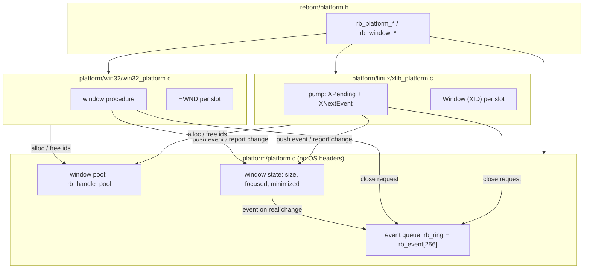

# Platform & windows

| | |
|---|---|
| **Status** | In progress |
| **Since** | v0.1.0 (2026-11-15) |
| **Updated** | v0.2.0 (2026-11-24) |
| **Code** | `engine/include/reborn/platform.h`, `engine/src/platform/` |
| **ADRs** | [0006](../adr/0006-platform-layer.md), [0007](../adr/0007-index-only-containers.md), [0013](../adr/0013-vulkan-renderer.md), [0020](../adr/0020-window-icon.md) |

## Summary
Windows and OS events behind one OS-independent API. Game and engine code never include an OS
header; each OS has its own backend, chosen by CMake.

## Spec
- Up to `RB_MAX_WINDOWS` (8) windows, referred to by generational handles: a destroyed window's
  handle is rejected, never undefined behaviour.
- Window sizes in logical units. Windows: scaled by the monitor's DPI (Per-Monitor V2); moving
  to a monitor with another scale keeps the logical size. Linux: pixels (X11 has no per-monitor
  scale), at most 32767.
- Titles are UTF-8. Windows: up to 255 UTF-16 units, invalid UTF-8 fails the creation. Linux:
  passed through unvalidated as `_NET_WM_NAME` and `WM_NAME` (`UTF8_STRING`).
- Events go through a 256-slot queue; when full, the newest event is dropped and counted, and
  each burst of drops logs one warning.
- Closing a window is a request (`RB_EVENT_WINDOW_CLOSE_REQUESTED`): the window lives until
  `rb_window_destroy`.
- Lifecycle events: `RESIZED` (logical and pixel size in `ev.resize`), `FOCUS_GAINED` / `FOCUS_LOST`
  (keyboard focus), `MINIMIZED` / `RESTORED`. Sent only on a real change; consecutive resizes of a
  window merge into the newest queued one. Maximizing is a resize.
- `MOVED` (`ev.position`): the client area's top left on the virtual screen (every monitor on one
  plane, origin at the primary's top left), in pixels, negative on monitors left of or above the
  primary. Sent only on a real change; consecutive moves of a window merge; kept while minimized.
  Windows delivers a drag's moves when the drag ends; X11 during the drag.
- Queries `rb_window_get_size`, `rb_window_get_position`, `rb_window_is_focused`,
  `rb_window_is_minimized` answer as of the last pump; stale handles give zero / false. A new
  window starts with its created size and position (Linux: the requested position; the window
  manager's placement follows as `MOVED`), not focused, not minimized; focus usually follows as an
  event.
- **Icon** (ADR 0020): `rb_window_desc.icons` / `icon_count`, one icon as `rb_image`s at several
  sizes (RGBA, straight alpha, rows from the top; `reborn/image.h`), set before the window is
  shown, so the system's default never flashes. Win32 picks, for the small (title bar) and the big
  icon (Alt+Tab, taskbar) at the window's DPI, the smallest image at least that large, else the
  largest; X11 passes every image in `_NET_WM_ICON` and the window manager picks. At most 8
  images of 1..256 pixels per side: beyond, logged, and the window opens with the system's icon.
  The pixels are read by `rb_window_create` only. Not yet: changing the icon later, the
  executable's icon, icons from image files.
- A minimized window keeps its size (Win32's 0×0 is not reported). Windows can report 0 pixels for
  a window shrunk to its title bar.
- Backends: **Win32** (Windows), **Xlib** (Linux; X11 or XWayland). Startup fails without an X
  server (`$DISPLAY` unset or unreachable).
- Pointer parameters (`state`, `desc`, `out`) must not be NULL: asserted in debug builds.
- Failures are logged with their reason (Win32: `GetLastError` text); startup, window creation
  (with the measured pixel size and DPI) and destruction are logged too.
- Keyboard and mouse events and state: see [input.md](input.md).
- Internal, stateless: dynamic libraries opened at run time (`rb_platform_library_open` /
  `_symbol` / `_close`); Windows searches only the application folder and System32. Sockets
  (`platform_socket.h`: Winsock, POSIX) for the command server and `reborn-cmd`
  ([commands.md](commands.md)).
- Not yet: window commands (set size, minimize, fullscreen).
- Known limits: while a window is dragged or resized, Windows runs its own loop and
  `rb_platform_pump` does not return. On Linux, an X protocol error or a lost connection ends the
  process (Xlib's default error handlers).

## Design

CMake compiles only the backend of the target OS, so each build contains one of the two.
Each backend's `struct rb_platform_state` embeds `rb_platform_common` as its first member, so
`platform.c` reaches the shared part through a pointer cast without knowing the backend.

Backends report what the OS says (`rb_platform_common_window_resized/focused/minimized`); the
common code compares with the stored state and queues an event only on a change, so the filtering
of redundant OS messages is written once and unit-tested. Win32: `WM_SIZE` (`SIZE_MINIMIZED`
becomes minimized, the size is kept), `WM_MOVE` (ignored while minimized: it reports
-32000,-32000), `WM_SETFOCUS` / `WM_KILLFOCUS`. Xlib: `ConfigureNotify`,
`FocusIn` / `FocusOut` (grab-induced ones ignored), `PropertyNotify` on ICCCM `WM_STATE`
(`IconicState`). The window manager reparents the X window into its frame, so `ConfigureNotify`
gives coordinates relative to the frame: a `ConfigureNotify` or `ReparentNotify` marks the window,
and after reading the events the pump asks the server once per marked window
(`XTranslateCoordinates` to the root).

Input (keys, buttons, mouse moves, wheel) follows the same pattern in `platform/input.c`, with the
OS code mapping in `win32_input.c` / `xlib_input.c`: see [input.md](input.md).

## API
```c
rb_arena engine;
rb_arena_create(&engine, RB_MIB(64));                /* lives as long as the engine */
rb_platform_state *platform = rb_platform_startup(rb_arena_allocator(&engine));
if (platform == NULL) { /* logged */ }
rb_window win = rb_window_create(
    platform, &(rb_window_desc){.title = "Reborn", .width = 1280, .height = 720});

for (bool running = true; running;) {
    rb_platform_pump(platform);
    rb_event ev;
    while (rb_platform_poll_event(platform, &ev)) {
        switch (ev.type) {
        case RB_EVENT_WINDOW_CLOSE_REQUESTED: running = false; break;
        case RB_EVENT_WINDOW_RESIZED: /* ev.resize.pixel_width, ... */ break;
        default: break;
        }
    }
    if (rb_window_is_minimized(platform, win)) continue; /* nothing to draw */
}

rb_window_destroy(platform, win);
rb_platform_shutdown(platform);                      /* frees the state through the arena */
rb_arena_destroy(&engine);
```

## Decisions
- One backend per OS chosen by CMake; state taken from an allocator given at startup (ADR 0006,
  B3; ADR 0010, K1); generational window handles;
  polled event queue; Xlib on Linux; physical key codes; UTF-8 strings (ADR 0006).
- State passed explicitly to every call; close is a request; sizes in logical units (ADR 0006).
- Window lifecycle: events + queries, one event type per transition, logical and pixel size in one
  resize, size kept while minimized, common state filters redundant OS messages, consecutive
  resizes merged, ICCCM `WM_STATE` for minimized on X11 (ADR 0006, G–N).
- Window position: client area origin in virtual screen pixels; on X11 translated by the server
  once per window per pump (ADR 0006, V–X).
- Messages sent while a window is created or destroyed produce no events (Win32 clears the slot
  before `DestroyWindow`).
- `UNICODE` is defined in the Win32 backend, so an accidental `-A` call fails to compile.
- The window is created hidden, sized with the DPI of the monitor it landed on
  (`GetDpiForWindow`, not `GetDpiForSystem`, which is fixed at logon), then shown.
- Icon at creation, several sizes, RGBA, drawn by each game in code (ADR 0020). Win32 builds each
  `HICON` from a 32-bit top-down DIB with an alpha mask and an empty AND mask; X11 converts the
  pixels to `unsigned long` values (64 bits on 64-bit Linux, as Xlib wants format 32), in a block
  freed right after `XChangeProperty`.
- Xlib: each window registers `WM_DELETE_WINDOW`, so the close button becomes a `ClientMessage`
  instead of the window manager killing the connection. Titles go to `_NET_WM_NAME` and `WM_NAME`
  as `UTF8_STRING` (`XStoreName` would type them Latin-1). No custom X error handlers yet.
- Vulkan surfaces (internal `platform/platform_vulkan.h`, ADR 0013, J1): each backend names its
  instance extension (`VK_KHR_win32_surface`, `VK_KHR_xlib_surface`) and creates the surface from
  its native handles, which never leave the platform. The Vulkan function comes from the
  instance's `vkGetInstanceProcAddr`: the platform does not link Vulkan either.

## Future work
- A native Wayland backend would have no window position (Wayland hides global coordinates).
- Window commands (set size, minimize, fullscreen); maximized as a state.
- Changing a window's icon after creation; icon sizes for a new DPI when a window moves monitor.
- Win32 modal loop: the game freezes while a window is dragged. The game loop clamps the frozen
  time ([app.md](app.md)); running during the drag still needs a solution (backlog).
- Linux: X error handling, UTF-8 title validation (parity with Windows), HiDPI via `Xft.dpi`.
- Integration tests beyond the application runs in `tests/app/test_app_run.c` (Windows only).

## History
| Version | Date | Change |
|---|---|---|
| v0.1.0 | 2026-11-15 | Public API, shared event queue, Win32 backend (create, close, DPI) |
| v0.1.0 | 2026-11-15 | Xlib backend (create, close request, UTF-8 titles); sandbox opens a window on Linux |
| v0.1.0 | 2026-11-15 | Logging of failures, window creation/destruction and queue overflow; NULL pointers asserted |
| v0.1.0 | 2026-11-15 | Window lifecycle: resize, focus, minimize events and queries; merged resizes |
| v0.1.0 | 2026-11-16 | Keyboard and mouse events and state ([input.md](input.md)) |
| v0.1.0 | 2026-11-16 | Owned by the application layer; `platform.h` stays public ([app.md](app.md)) |
| v0.1.0 | 2026-11-16 | Window position: `RB_EVENT_WINDOW_MOVED`, `rb_window_get_position` |
| v0.1.0 | 2026-11-16 | Startup takes an `rb_allocator` and returns the state; `rb_platform_state_size` removed |
| v0.1.0 | 2026-11-17 | Internal dynamic library loading (`rb_platform_library_*`, [renderer.md](renderer.md)) |
| v0.1.0 | 2026-11-17 | Vulkan surface creation for the renderer (internal) |
| v0.2.0 | 2026-11-24 | Window icon at creation (`rb_window_desc.icons`, `rb_image`) |
| v0.2.0 | 2026-11-24 | Internal sockets for the command server ([commands.md](commands.md)) |
