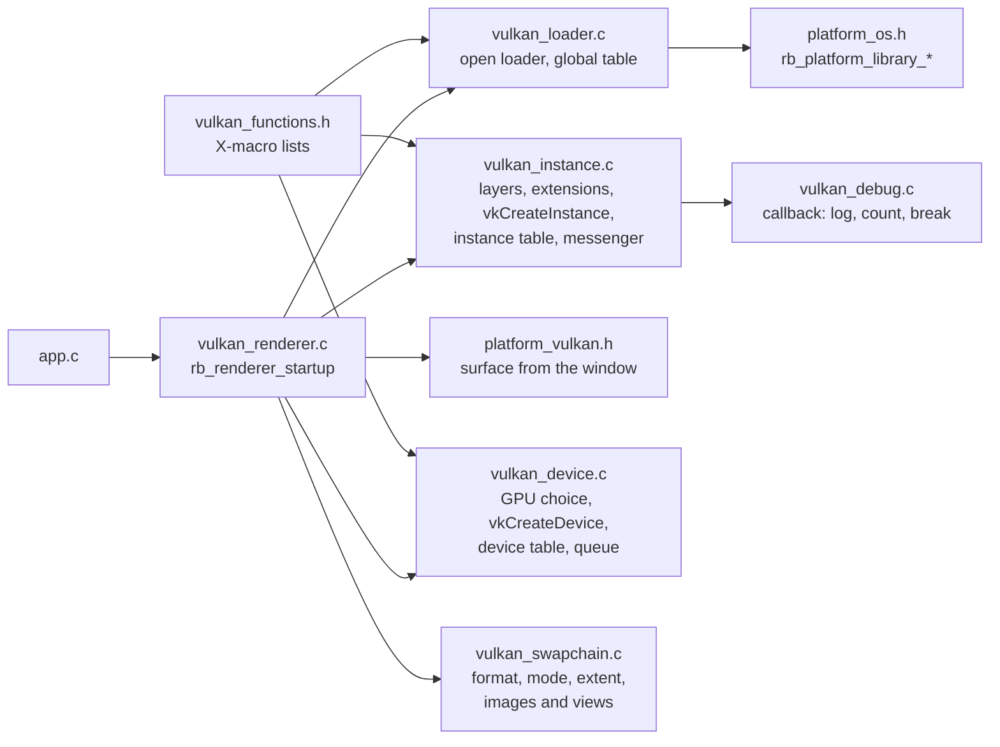

# Vulkan renderer

| | |
|---|---|
| **Status** | In progress |
| **Since** | v0.1.0 (2026-11-17) |
| **Updated** | v0.1.0 (2026-11-17) |
| **Code** | `engine/include/reborn/renderer.h`, `engine/src/renderer/`, `engine/src/platform/platform_vulkan.h`, `engine/src/platform/*/…_library.c` |
| **ADRs** | [0013](../adr/0013-vulkan-renderer.md) |

## Summary
Draws through Vulkan 1.3 into a window, on Windows and Linux. Built step by step (roadmap §7); so
far it opens the Vulkan loader at run time, creates an instance with validation layers reporting
to the engine's log, picks a GPU, opens a device and keeps a swapchain sized to the window.

## Spec
- `rb_renderer_startup(allocator, config, platform, window)` returns an opaque `rb_renderer`, or
  NULL (logged) when Vulkan is missing, offers less than 1.3, no GPU can present to the window, the
  window is stale, or memory runs out; nothing is left allocated or open then. The state is tagged
  `RB_MEMORY_TAG_RENDERER`. The platform and the window must outlive the renderer.
- A window is required: rendering without one is in the backlog (tools, offscreen tests).
- The application layer starts it on the main window and stops it before the window; games reach
  it with `rb_app_renderer` and configure it in `rb_app_config.renderer`.
- **GPU:** suitable when it offers Vulkan 1.3, `VK_KHR_swapchain` and a queue family that both
  draws and presents to the window. Among those: discrete > integrated > virtual > CPU, ties in the
  loader's order. Every GPU is logged at INFO with its verdict; a CPU implementation (lavapipe)
  is used as a last resort, with a warning. Dynamic rendering and synchronization2 are enabled.
- **Swapchain:** `B8G8R8A8_SRGB` or `R8G8B8A8_SRGB` (sRGB nonlinear), else the first format with a
  warning; the driver's minimum image count + 1; one image view per image. `config.vsync` (on in
  the app's defaults): FIFO; off: MAILBOX, else IMMEDIATE, else FIFO.
- **Resize:** at the start of every frame the app asks the renderer whether the frame can be shown;
  when the window's pixel size changed, the swapchain is rebuilt (the old one passed as
  `oldSwapchain`). Not while minimized; with zero pixels there is no swapchain until the window has
  some again. A failed rebuild is logged once and leaves no swapchain until the size changes.
- The executable never links the Vulkan loader: it opens `vulkan-1.dll` / `libvulkan.so.1` while
  running, so a machine without Vulkan gets a logged error instead of a program that cannot start.
- **Validation** (`config.validation`, default on in debug builds of the engine): enables
  `VK_LAYER_KHRONOS_validation` and a `VK_EXT_debug_utils` messenger, which also covers instance
  creation and destruction. Without the layer: a warning, and the renderer runs unchecked.
- **Messages:** logged as `Vulkan <type>: <text>`; error → ERROR, warning → WARN, info → DEBUG
  (loader info → TRACE), verbose → TRACE. Validation errors and warnings are counted
  (`rb_renderer_get_validation_stats`); shutdown logs the totals. The first error of each message
  ID (up to 64) stops in an attached debugger, inside the offending Vulkan call.
- Every Vulkan function is called through a table loaded for the object it belongs to (loader,
  instance, device); calling one directly does not compile (`VK_NO_PROTOTYPES`).
- Vulkan's host allocations use the driver's allocator (`pAllocator` NULL): not tracked by tag.
- Needs the Vulkan headers to build (Vulkan SDK on Windows, `libvulkan-dev` on Linux); tests need a
  Vulkan 1.3 driver and the validation layers (lavapipe and `vulkan-validationlayers` in the Linux
  container). Tests that start the renderer open a window: Windows only; the Linux container runs
  the instance tests and the pure ones (GPU ranking, swapchain choices).
- Not yet: drawing, presenting.

## Design


Startup order (shutdown is the reverse): loader → instance (+ messenger) → surface → device →
swapchain.

- `vulkan_api.h` is the only include of `<vulkan/vulkan.h>`, with `VK_NO_PROTOTYPES`.
- `vulkan_functions.h` names each function once per level (X-macro); the list generates the table
  fields and the loading code.
- `rb_vk_debug` (stats and stopped-on error IDs) lives in the renderer state: its address is the
  messenger's user data, so it must stay put while the instance exists.
- Dynamic libraries are a platform service (`platform_os.h`, stateless, internal).
- The surface is created by the platform backend (`platform_vulkan.h`), so `HWND`, `Display *` and
  `Window` never reach the renderer, which has no `#ifdef` per OS.
- `renderer_destroy_objects` destroys whatever exists in reverse order; a startup that fails
  halfway uses it too, so each step only has to leave its own object zeroed on failure.
- The swapchain's images and views live in fixed arrays (8): a rebuild allocates nothing that
  outlives it.
- `rb_renderer_prepare_frame` (`renderer/renderer_internal.h`) is for the app only: the app drives
  the frame. It compares the window's pixel size, as of the last pump, with the size the swapchain
  was built for, so a resize event dropped from the queue still triggers the rebuild.

## API
```c
/* Under the application layer: configure, then reach it from a callback. */
static bool game_configure(rb_app_config *config) {
    config->renderer.validation = true; /* also in a release build */
    return true;
}
rb_renderer *renderer = rb_app_renderer(app);

/* Tools and tests drive it directly. */
rb_renderer *renderer = rb_renderer_startup(rb_heap_allocator(),
                                            &(rb_renderer_config){.validation = true, .vsync = true},
                                            platform, window);
rb_renderer_validation_stats stats = rb_renderer_get_validation_stats(renderer);
rb_renderer_shutdown(renderer); /* "Vulkan validation: no errors or warnings" */
```

## Decisions
- Headers from the SDK / distro packages, not vendored (ADR 0013, A1).
- Loader opened at run time by our own code, not linked and not `volk` (ADR 0013, B2).
- Function pointers in per-object tables with full Vulkan names, not globals (ADR 0013, C2).
- Vulkan 1.3 minimum: dynamic rendering and synchronization2 in core (ADR 0013, D3).
- Validation from the build type, overridable in the config (E2, I1); logged, counted, debugger
  stop on the first error of each kind (F3).
- Public API now, started by the application layer (G2, H1).
- Windows searches libraries only in the application folder and System32 (no DLL planting).
- Surface created by the platform (J1); a window is required (K2).
- GPU ranked by type, lavapipe as last resort (L2, M1); one queue for graphics and present (N1).
- `vsync` in the config (O2); sRGB swapchain (P1); rebuilt when the window's pixel size changes,
  checked each frame (Q1).

## Future work
- Pipeline, command buffers, synchronization, acquire and present (with
  `VK_ERROR_OUT_OF_DATE_KHR` as a second rebuild trigger); first triangle (roadmap §7).
- Rendering without a window; choosing the GPU by name or index (backlog).
- The game's name in `VkApplicationInfo` (drivers use it for per-game profiles).
- Route Vulkan's host allocations through `rb_allocator` if tracking needs it.

## History
| Version | Date | Change |
|---|---|---|
| v0.1.0 | 2026-11-17 | Vulkan loader opened at run time, global function table |
| v0.1.0 | 2026-11-17 | Public `rb_renderer`, Vulkan 1.3 instance, validation with log, counters and debugger stop; started by the app |
| v0.1.0 | 2026-11-17 | Surface from the platform, GPU choice, device, swapchain rebuilt on resize; startup takes the window |
