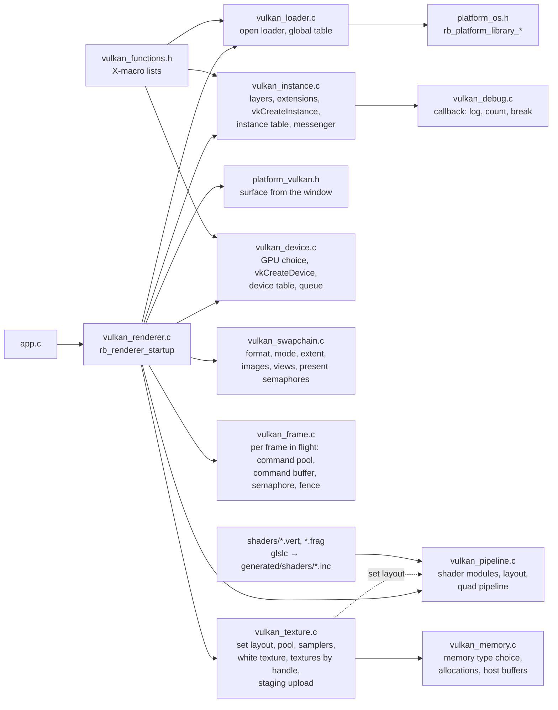
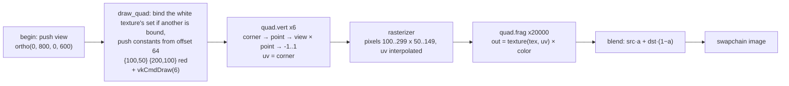
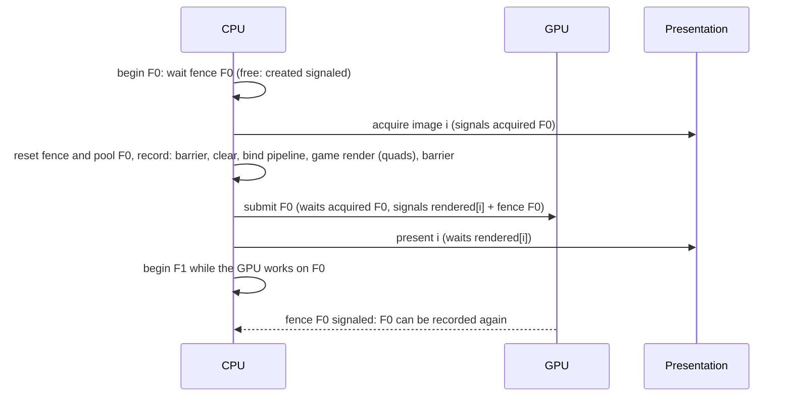

# Vulkan renderer

| | |
|---|---|
| **Status** | In progress |
| **Since** | v0.1.0 (2026-11-17) |
| **Updated** | v0.2.0 (2026-11-23) |
| **Code** | `engine/include/reborn/renderer.h`, `engine/include/reborn/color.h`, `engine/src/core/color.c`, `engine/src/renderer/`, `engine/src/platform/platform_vulkan.h`, `engine/src/platform/*/…_library.c` |
| **ADRs** | [0013](../adr/0013-vulkan-renderer.md), [0015](../adr/0015-shaders-and-graphics-pipeline.md), [0016](../adr/0016-math-and-2d-camera.md), [0017](../adr/0017-gpu-memory-and-textures.md) |

## Summary
Draws through Vulkan 1.3 into a window, on Windows and Linux. Built step by step; so
far it opens the Vulkan loader at run time, creates an instance with validation layers reporting
to the engine's log, picks a GPU, opens a device, keeps a swapchain sized to the window and
presents a frame cleared to a color the game sets, with two frames in flight. The game draws
colored or textured quads through one graphics pipeline, its shaders compiled at build time, in
window pixels or in world units through a 2D camera ([camera2d.md](camera2d.md)). Textures are
created from RGBA pixels and live in GPU memory.

## Spec
- `rb_renderer_startup(allocator, config, platform, window)` returns an opaque `rb_renderer`, or
  NULL (logged) when Vulkan is missing, offers less than 1.3, no GPU can present to the window, the
  window is stale, or memory runs out; nothing is left allocated or open then. The state is tagged
  `RB_MEMORY_TAG_RENDERER`. The platform and the window must outlive the renderer.
- A window is required: rendering without one is in the backlog (tools, offscreen tests).
- The application layer starts it on the main window and stops it before the window; games reach
  it with `rb_app_renderer` and configure it in `rb_app_config.renderer`.
- **GPU:** suitable when it offers Vulkan 1.3, `VK_KHR_swapchain` and a queue family that both
  draws and presents to the window. Among those: discrete > integrated > virtual > CPU, ties in the
  loader's order. Every GPU is logged at INFO with its verdict; a CPU implementation (lavapipe)
  is used as a last resort, with a warning. Dynamic rendering and synchronization2 are enabled.
- **Swapchain:** `B8G8R8A8_SRGB` or `R8G8B8A8_SRGB` (sRGB nonlinear), else the first format with a
  warning; the driver's minimum image count + 1; one image view per image. `config.vsync` (on in
  the app's defaults): FIFO; off: MAILBOX, else IMMEDIATE, else FIFO.
- **Frame:** the app calls `rb_renderer_begin_frame`; when it returns true, the game's `render`,
  then `rb_renderer_end_frame`. Begin waits for the frame's fence, acquires a swapchain image and
  begins dynamic rendering, cleared to the clear color; end transitions the image for
  presentation, submits and presents. Two frames in flight: the CPU records one while the GPU
  draws the other. With FIFO, waiting for a free image paces the loop to the monitor's refresh.
- **Clear color:** `rb_renderer_set_clear_color(renderer, rb_color)`, dark gray by default, used
  from the next frame begun (the current one is already cleared).
- **Quads:** `rb_renderer_draw_quad(renderer, x, y, width, height, color)` from the game's
  `render`: a filled rectangle in the current space, by default `f32` pixels of the client area,
  origin top left, y down (the coordinates of `rb_mouse_position`), fractions allowed. Drawn in
  call order, each on top of the previous ones; alpha blends with what is underneath (straight
  alpha). Outside a frame: `RB_ASSERT`. One draw call per quad.
- **Space:** `rb_renderer_set_camera(renderer, &camera)` switches the following draws to world
  units, clipped to the camera's field (bars elsewhere); `NULL` back to window pixels. Each frame
  begins in pixels. Details in [camera2d.md](camera2d.md).
- **Textures:** `rb_renderer_create_texture(renderer, &(rb_texture_desc){width, height, pixels,
  filter})` copies `width * height * 4` bytes (RGBA, sRGB, straight alpha, rows from the top) to
  the GPU and waits for the copy; callable at any time, `render` included. Zero handle on failure
  (logged): a side of 0 or beyond `maxImageDimension2D`, `RB_RENDERER_MAX_TEXTURES` (256) alive,
  out of GPU memory. `filter`: `RB_TEXTURE_FILTER_NEAREST` (sharp texels) or `_LINEAR` (blended);
  edges clamp, no mipmaps. `rb_renderer_destroy_texture` waits for the GPU to go idle (a stall:
  for unloading), ignores stale and zero handles, and must not be called inside `render`
  (`RB_ASSERT`). Textures still alive are freed at shutdown.
- **Textured quads:** `rb_renderer_draw_texture(renderer, x, y, width, height, texture, tint)`:
  like a quad, the whole texture stretched over it, its top-left pixel at (x, y), each pixel
  multiplied by `tint`. A zero or stale handle draws a plain quad of the tint's color.
  `rb_renderer_draw_quad` is the same draw with an internal 1x1 white texture.
- **Pipeline:** one, built at startup for the swapchain's format (a failure fails the startup),
  rebuilt only if a new swapchain comes with another format (a failure then stops drawing). No
  vertex buffers, no culling, viewport and scissor set at each frame's begin and each change of
  space.
- **Shaders:** GLSL in `engine/src/renderer/vulkan/shaders/`, compiled to SPIR-V by `glslc` at
  build time and embedded in the engine (see the build system page): nothing to load at run
  time, a shader error fails the build.
- **Colors** (`reborn/color.h`): `rb_color` is linear RGB with straight alpha. `rb_color_srgb`
  takes color-picker values and converts them with the exact sRGB curve (clamped to [0, 1], alpha
  untouched); `rb_color_linear` takes linear values as they are (above 1 allowed).
- **Resize:** at the start of every frame (begin), when the window's pixel size changed, or
  acquire or present reported the swapchain out of date or suboptimal, the swapchain is rebuilt (the old one passed as
  `oldSwapchain`). Not while minimized; with zero pixels there is no swapchain until the window has
  some again. A failed rebuild is logged once and leaves no swapchain until the size changes.
  Out of date at acquire skips the frame; suboptimal still shows it.
- **Errors:** any other Vulkan failure while drawing (device lost, out of memory) is logged once;
  the renderer then shows nothing more, and the run goes on.
- The executable never links the Vulkan loader: it opens `vulkan-1.dll` / `libvulkan.so.1` while
  running, so a machine without Vulkan gets a logged error instead of a program that cannot start.
- **Validation** (`config.validation`, default on in debug builds of the engine): enables
  `VK_LAYER_KHRONOS_validation` and a `VK_EXT_debug_utils` messenger, which also covers instance
  creation and destruction. Without the layer: a warning, and the renderer runs unchecked.
- **Messages:** logged as `Vulkan <type>: <text>`; error → ERROR, warning → WARN, info → DEBUG
  (loader info → TRACE), verbose → TRACE. Validation errors and warnings are counted
  (`rb_renderer_get_validation_stats`); shutdown logs the totals. The first error of each message
  ID (up to 64) stops in an attached debugger, inside the offending Vulkan call.
- Every Vulkan function is called through a table loaded for the object it belongs to (loader,
  instance, device); calling one directly does not compile (`VK_NO_PROTOTYPES`).
- Vulkan's host allocations use the driver's allocator (`pAllocator` NULL): not tracked by tag.
- **GPU memory:** one `vkAllocateMemory` per image and per staging buffer, in the first memory
  type that fits: device-local for images, host-visible and coherent for staging. The heaps and
  types are logged at DEBUG at startup.
- Needs the Vulkan headers to build (Vulkan SDK on Windows, `libvulkan-dev` on Linux); tests need a
  Vulkan 1.3 driver and the validation layers (lavapipe and `vulkan-validationlayers` in the Linux
  container). Tests that start the renderer open a window: Windows only; the Linux container runs
  the instance tests and the pure ones (GPU ranking, swapchain choices).
- Mesa's CPU driver (lavapipe) on X11 does not wait for the refresh with FIFO: the frame rate is
  unbounded there (Xvfb and WSLg included) unless `max_fps` is set.

## Design


Startup order (shutdown is the reverse): loader → instance (+ messenger) → surface → device →
textures (shared objects and the white texture) → swapchain → pipeline → frames in flight.

A quad through the pipeline (window 800x600, pixels, `draw_quad(100, 50, 200, 100, red)`):



A frame, over time (two frames in flight, F0 and F1):



- `vulkan_api.h` is the only include of `<vulkan/vulkan.h>`, with `VK_NO_PROTOTYPES`.
- `vulkan_functions.h` names each function once per level (X-macro); the list generates the table
  fields and the loading code.
- `rb_vk_debug` (stats and stopped-on error IDs) lives in the renderer state: its address is the
  messenger's user data, so it must stay put while the instance exists.
- Dynamic libraries are a platform service (`platform_os.h`, stateless, internal).
- The surface is created by the platform backend (`platform_vulkan.h`), so `HWND`, `Display *` and
  `Window` never reach the renderer, which has no `#ifdef` per OS.
- `renderer_destroy_objects` destroys whatever exists in reverse order; a startup that fails
  halfway uses it too, so each step only has to leave its own object zeroed on failure.
- The swapchain's images and views live in fixed arrays (8): a rebuild allocates nothing that
  outlives it.
- `rb_renderer_begin_frame` / `_end_frame` (`renderer/renderer_internal.h`) are for the app only:
  the app drives the frame. Begin compares the window's pixel size, as of the last pump, with the
  size the swapchain was built for, so a resize event dropped from the queue still triggers the
  rebuild.
- Begin checks everything that can fail before acquiring: once an image is acquired, the frame
  always reaches the present. The fence is reset only after a successful acquire, otherwise a
  skipped frame would leave a fence nobody signals.
- The presentation semaphore is per swapchain image, not per frame in flight: present signals
  nothing back, and the image returning from acquire is the only sign that its present is over.
- Barriers and the submit use synchronization2 (`vkCmdPipelineBarrier2`, `vkQueueSubmit2`).
- A quad needs no GPU memory: the vertex shader picks one of six corners with `gl_VertexIndex`
  and scales it by the quad's rectangle, received as push constants. `rb_vk_quad_push` (96 bytes:
  view matrix, position, size, color) mirrors the block in `shaders/quad.glsl`, shared by both
  shaders; `_Static_assert`s check offsets and size. The view (64 bytes) is pushed when the space
  changes, each quad pushes only its 32 bytes: push constants persist across draws.
- A texture is an image (optimal tiling, `R8G8B8A8_SRGB`), its memory, a view and a descriptor
  set (binding 0: combined image sampler, read by the fragment shader) written once at creation
  with the sampler of its filter. The set layout is set 0 of the pipeline layout; the pool holds
  `RB_RENDERER_MAX_TEXTURES + 1` sets (the white texture's included) and frees them one by one.
  Textures live in a fixed array indexed by their handle (`rb_handle_pool`).
- Upload: a host-visible staging buffer, a transient command pool and a fence per upload;
  barriers UNDEFINED → TRANSFER_DST → copy → SHADER_READ_ONLY (fragment shader reads), submitted
  on the frames' queue, waited for, then freed. The barrier also orders the copy before every
  later frame on the queue.
- Each frame begins with no set bound (`bound_set`); a draw binds its texture's set only when it
  differs from the last one.
- Dynamic rendering bakes the image format into the pipeline: `rb_vk_pipeline.color_format`
  records it, so a swapchain with another format triggers a rebuild.

## API
```c
/* Under the application layer: configure, then reach it from a callback. */
static bool game_configure(rb_app_config *config) {
    config->renderer.validation = true; /* also in a release build */
    return true;
}
static void game_render(void *state, rb_app *app, f64 alpha) {
    rb_renderer *renderer = rb_app_renderer(app);
    rb_renderer_set_clear_color(renderer, rb_color_srgb(1.0f, 0.5f, 0.0f, 1.0f));
    /* 200x100 pixels, top-left corner at (100, 50); then a translucent one on top. */
    rb_renderer_draw_quad(renderer, 100, 50, 200, 100, rb_color_srgb(1.0f, 0.0f, 0.0f, 1.0f));
    rb_renderer_draw_quad(renderer, 150, 80, 100, 100, rb_color_srgb(0.0f, 0.0f, 1.0f, 0.5f));
    /* A texture made in init, enlarged to 128x128, untinted. */
    game_state *game = state;
    rb_renderer_draw_texture(renderer, 400, 50, 128, 128, game->checker, rb_color_srgb(1, 1, 1, 1));
}

/* Textures: created when loading, destroyed outside `render`. */
static bool game_init(void *state, rb_app *app) {
    game_state *game = state;
    u8 pixels[2 * 2 * 4] = {255, 0, 0, 255,  0, 255, 0, 255,  0, 0, 255, 255,  255, 255, 255, 255};
    game->checker = rb_renderer_create_texture(
        rb_app_renderer(app), &(rb_texture_desc){.width = 2, .height = 2, .pixels = pixels,
                                                 .filter = RB_TEXTURE_FILTER_NEAREST});
    return true; /* a zero handle (logged) draws a plain quad */
}
static void game_shutdown(void *state, rb_app *app) {
    game_state *game = state;
    rb_renderer_destroy_texture(rb_app_renderer(app), game->checker);
}

/* Tools and tests drive it directly. */
rb_renderer *renderer = rb_renderer_startup(rb_heap_allocator(),
                                            &(rb_renderer_config){.validation = true, .vsync = true},
                                            platform, window);
rb_renderer_validation_stats stats = rb_renderer_get_validation_stats(renderer);
rb_renderer_shutdown(renderer); /* "Vulkan validation: no errors or warnings" */
```

## Decisions
- Headers from the SDK / distro packages, not vendored (ADR 0013, A1).
- Loader opened at run time by our own code, not linked and not `volk` (ADR 0013, B2).
- Function pointers in per-object tables with full Vulkan names, not globals (ADR 0013, C2).
- Vulkan 1.3 minimum: dynamic rendering and synchronization2 in core (ADR 0013, D3).
- Validation from the build type, overridable in the config (E2, I1); logged, counted, debugger
  stop on the first error of each kind (F3).
- Public API now, started by the application layer (G2, H1).
- Windows searches libraries only in the application folder and System32 (no DLL planting).
- Surface created by the platform (J1); a window is required (K2).
- GPU ranked by type, lavapipe as last resort (L2, M1); one queue for graphics and present (N1).
- `vsync` in the config (O2); sRGB swapchain (P1); rebuilt when the window's pixel size changes,
  checked each frame (Q1).
- Command buffers and synchronization before shaders (R2); two frames in flight (S2); presentation
  semaphore per swapchain image (T2); one command pool per frame, reset whole (U1).
- The app brackets `render` with begin / end frame (V1); public clear color setter (W3); no frame
  cap by default (X2).
- Colors: linear inside, sRGB and linear constructors (Y3), in their own header (Z2).
- A public `rb_renderer_draw_quad` after a first triangle (ADR 0015, A3), in window pixels (B1).
- GLSL (C1) compiled by `glslc` at build time (D1), embedded for the engine's own shaders (E3).
- Corners in the shader, quad data as push constants (F1); dynamic viewport and scissor (G1);
  straight alpha blending (H2).
- A view matrix replaces the target size; a current camera, `NULL` for pixels (ADR 0016, A1, G1).
- Public textures with create, destroy and tinted draw (ADR 0017, A2); one device allocation per
  resource (B1); blocking staging upload (C1); one descriptor set per texture (D1); nearest or
  linear per texture (E3); RGBA8 sRGB (F1); destroy waits for the GPU (G1).

## Future work
- Batched 2D renderer with vertex buffers, when a game draws many sprites; bindless textures or
  atlases with it (ADR 0017, D2).
- A source rectangle per textured draw, with fonts (ADR 0017, A3).
- GPU memory block allocator, uploads without a stall, deferred destruction (ADR 0017, B2, C2,
  G2); premultiplied alpha with image decoding.
- Shaders as files next to the executable, with hot reload (ADR 0015, E2).
- Recovering from a lost device instead of stopping.
- Rendering without a window; choosing the GPU by name or index (backlog).
- The game's name in `VkApplicationInfo` (drivers use it for per-game profiles).
- Route Vulkan's host allocations through `rb_allocator` if tracking needs it.

## History
| Version | Date | Change |
|---|---|---|
| v0.1.0 | 2026-11-17 | Vulkan loader opened at run time, global function table |
| v0.1.0 | 2026-11-17 | Public `rb_renderer`, Vulkan 1.3 instance, validation with log, counters and debugger stop; started by the app |
| v0.1.0 | 2026-11-17 | Surface from the platform, GPU choice, device, swapchain rebuilt on resize; startup takes the window |
| v0.1.0 | 2026-11-17 | Frames: two in flight, cleared and presented each loop iteration; `rb_renderer_set_clear_color`, `reborn/color.h` |
| v0.1.0 | 2026-11-17 | Shaders compiled at build time and embedded, quad pipeline, `rb_renderer_draw_quad` |
| v0.2.0 | 2026-11-23 | `rb_renderer_set_camera`: world units through a 2D camera, letterboxed; a view matrix in the push constants |
| v0.2.0 | 2026-11-23 | Textures: device memory, staging upload, samplers, descriptor sets; `rb_texture`, `rb_renderer_draw_texture`; plain quads sample a white texture |
