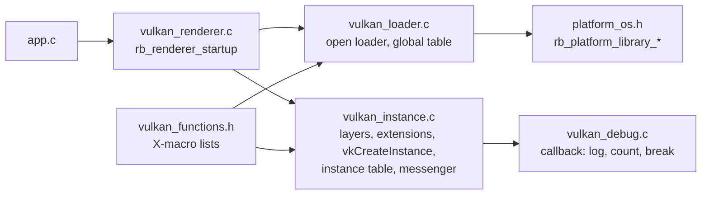

# Vulkan renderer

| | |
|---|---|
| **Status** | In progress |
| **Since** | v0.1.0 (2026-11-17) |
| **Updated** | v0.1.0 (2026-11-17) |
| **Code** | `engine/include/reborn/renderer.h`, `engine/src/renderer/vulkan/`, `engine/src/platform/*/…_library.c` |
| **ADRs** | [0013](../adr/0013-vulkan-renderer.md) |

## Summary
Draws through Vulkan 1.3 on Windows and Linux. Built step by step (roadmap §7); so far it opens
the Vulkan loader at run time and creates an instance, with validation layers reporting to the
engine's log.

## Spec
- `rb_renderer_startup(allocator, config)` returns an opaque `rb_renderer`, or NULL (logged) when
  Vulkan is missing, offers less than 1.3, has no driver, or memory runs out; nothing is left
  allocated or open then. The state is tagged `RB_MEMORY_TAG_RENDERER`.
- The application layer starts it after the main window and stops it before; games reach it with
  `rb_app_renderer` and configure it in `rb_app_config.renderer`.
- The executable never links the Vulkan loader: it opens `vulkan-1.dll` / `libvulkan.so.1` while
  running, so a machine without Vulkan gets a logged error instead of a program that cannot start.
- **Validation** (`config.validation`, default on in debug builds of the engine): enables
  `VK_LAYER_KHRONOS_validation` and a `VK_EXT_debug_utils` messenger, which also covers instance
  creation and destruction. Without the layer: a warning, and the renderer runs unchecked.
- **Messages:** logged as `Vulkan <type>: <text>`; error → ERROR, warning → WARN, info → DEBUG
  (loader info → TRACE), verbose → TRACE. Validation errors and warnings are counted
  (`rb_renderer_get_validation_stats`); shutdown logs the totals. The first error of each message
  ID (up to 64) stops in an attached debugger, inside the offending Vulkan call.
- Every Vulkan function is called through a table loaded for the object it belongs to (loader,
  instance, later device); calling one directly does not compile (`VK_NO_PROTOTYPES`).
- Vulkan's host allocations use the driver's allocator (`pAllocator` NULL): not tracked by tag.
- Needs the Vulkan headers to build (Vulkan SDK on Windows, `libvulkan-dev` on Linux); tests need a
  Vulkan 1.3 driver and the validation layers (lavapipe and `vulkan-validationlayers` in the Linux
  container).
- Not yet: surface, devices, swapchain, drawing.

## Design


- `vulkan_api.h` is the only include of `<vulkan/vulkan.h>`, with `VK_NO_PROTOTYPES`.
- `vulkan_functions.h` names each function once per level (X-macro); the list generates the table
  fields and the loading code.
- `rb_vk_debug` (stats and stopped-on error IDs) lives in the renderer state: its address is the
  messenger's user data, so it must stay put while the instance exists.
- Dynamic libraries are a platform service (`platform_os.h`, stateless, internal).

## API
```c
/* Under the application layer: configure, then reach it from a callback. */
static bool game_configure(rb_app_config *config) {
    config->renderer.validation = true; /* also in a release build */
    return true;
}
rb_renderer *renderer = rb_app_renderer(app);

/* Tools and tests drive it directly. */
rb_renderer *renderer = rb_renderer_startup(rb_heap_allocator(),
                                            &(rb_renderer_config){.validation = true});
rb_renderer_validation_stats stats = rb_renderer_get_validation_stats(renderer);
rb_renderer_shutdown(renderer); /* "Vulkan validation: no errors or warnings" */
```

## Decisions
- Headers from the SDK / distro packages, not vendored (ADR 0013, A1).
- Loader opened at run time by our own code, not linked and not `volk` (ADR 0013, B2).
- Function pointers in per-object tables with full Vulkan names, not globals (ADR 0013, C2).
- Vulkan 1.3 minimum: dynamic rendering and synchronization2 in core (ADR 0013, D3).
- Validation from the build type, overridable in the config (E2, I1); logged, counted, debugger
  stop on the first error of each kind (F3).
- Public API now, started by the application layer (G2, H1).
- Windows searches libraries only in the application folder and System32 (no DLL planting).

## Future work
- Surface, devices, swapchain; pipeline, command buffers, synchronization; first triangle
  (roadmap §7). `rb_renderer_startup` will take the window for the surface.
- The game's name in `VkApplicationInfo` (drivers use it for per-game profiles).
- Route Vulkan's host allocations through `rb_allocator` if tracking needs it.

## History
| Version | Date | Change |
|---|---|---|
| v0.1.0 | 2026-11-17 | Vulkan loader opened at run time, global function table |
| v0.1.0 | 2026-11-17 | Public `rb_renderer`, Vulkan 1.3 instance, validation with log, counters and debugger stop; started by the app |
