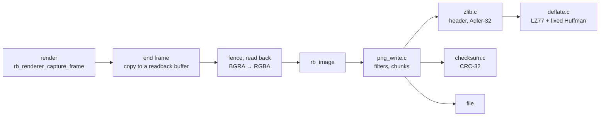

# Screen capture and PNG writing

| | |
|---|---|
| **Status** | In progress |
| **Since** | v0.2.0 (2026-11-26) |
| **Updated** | v0.2.0 (2026-11-26) |
| **Code** | `engine/include/reborn/image.h`, `engine/src/image/`, `engine/src/compression/`, `engine/src/core/checksum.c`, `engine/src/renderer/vulkan/vulkan_capture.c`, `engine/src/app/app_screen.c` |
| **ADRs** | [0024](../adr/0024-screen-capture-and-png.md) |

## Summary
A frame as the window shows it, back in CPU memory and saved as PNG: an agent opens the file and
sees what the player sees (`screen.capture`), a game saves screenshots or makes thumbnails. The
PNG writer stands on reusable layers: checksums, DEFLATE and zlib, the PNG container.

## Spec
- **Capture:** `rb_renderer_capture_frame` inside a frame books it; when the frame ends its
  swapchain image is copied to a host-visible buffer, presented as usual, and read back after the
  frame's fence. `rb_renderer_captured_image` returns RGBA, sRGB, opaque pixels at the window's
  pixel size, owned by the renderer until the next capture.
- **Cost:** the frame's end waits for the GPU; encoding runs on the main thread. A 1600x900 frame
  takes about 0.1 s in release and up to 1 s in debug, from capture to file: for debugging and
  occasional screenshots, not for video.
- **Command:** `screen.capture [path]` renders a frame of its own (the game's render with alpha 0)
  and writes the PNG; default `screenshot-<frame>.png` in the working directory. Replies `path`,
  `width`, `height`, `bytes`, `frame`, `step`. Errors: minimized window, no capture on this GPU,
  file not written.
- **PNG:** 8-bit RGB when every pixel is opaque, RGBA otherwise; one `IDAT`; per row the filter
  (None, Sub, Up, Average, Paeth) with the smallest sum of absolute values. Blink's 1600x900
  frames take about 30 KB (4.3 MB raw).
- **DEFLATE:** one block with the fixed Huffman codes; LZ77 over a 32 KiB window, 3-byte hash
  chains of at most 32 candidates. Any decoder reads it; zlib's dynamic codes would be smaller.
- **Limits:** swapchain formats B8G8R8A8 and R8G8B8A8 (sRGB or UNORM); a GPU whose window images
  cannot be copied (`TRANSFER_SRC`) has no captures (warned at startup). Paths go to `fopen` as
  they are: non-ASCII paths are not portable on Windows yet. No PNG reading yet.
- **Memory:** tag `RB_MEMORY_TAG_IMAGE`: the last capture's pixels (heap, reused while the size
  stays) and the encoder's scratch (about twice the pixels, freed before the return).

## Design

- `core/checksum.c`: CRC-32 and Adler-32, each continuing from a previous value.
- `compression/deflate.c`, `compression/zlib.c`: compress any bytes; `rb_deflate_bound` and
  `rb_zlib_bound` size the output, scratch from an allocator. Reusable by other file formats.
- `image/png_write.c`: `rb_png_encode` into memory, `rb_image_write_png` to a file. A later
  format adds its own writer next to it.
- `renderer/vulkan/vulkan_capture.c`: the copy's barriers and buffer, the read back, the
  conversion.
- `tests/support/inflate.c`: a decoder for stored and fixed-Huffman blocks; tests check every
  layer by a round trip.

## API
```c
/* In render: */
rb_renderer_capture_frame(rb_app_renderer(app));

/* After the frame (the next update): */
const rb_image *shot = rb_renderer_captured_image(rb_app_renderer(app));
usize           bytes;
if (shot != NULL && rb_image_write_png(shot, "shot.png", rb_app_allocator(app), &bytes)) {
    /* shot->pixels can also become a texture: rb_renderer_create_texture */
}
```
```sh
./build/debug/bin/reborn-cmd 7777 "step 30" "screen.capture after.png"
```
The sandbox's P key captures the next frame, saves `sandbox-capture.png` and shows it as a
thumbnail in the panel at the top, right of the row of squares.

## Decisions
- The command renders its own frame and replies at once (ADR 0024, A1).
- The swapchain image, created with `TRANSFER_SRC` where offered (B1).
- Own encoder: LZ77 and fixed Huffman codes, a filter per row (C2).
- Layers by concern, no generic encoder interface until a second encoder (D2).

## Future work
- Golden-image tests: captures compared with reference images (needs a PNG decoder).
- PNG decoding for textures and icons, growing from the tests' inflate (dynamic Huffman codes).
- Dynamic Huffman codes, if file sizes matter; encoding on a thread if captures get frequent.
- Captures without `TRANSFER_SRC` and without a window: an offscreen render target (B2).

## History
| Version | Date | Change |
|---|---|---|
| v0.2.0 | 2026-11-26 | First version: frame capture, `screen.capture`, PNG writer on checksums, DEFLATE and zlib; the sandbox's capture panel |
