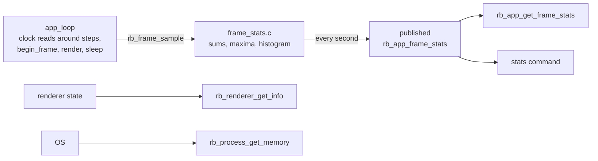

# Statistics

| | |
|---|---|
| **Status** | In progress |
| **Since** | v0.2.0 (2026-11-27) |
| **Updated** | v0.2.0 (2026-11-27) |
| **Code** | `engine/src/app/frame_stats.c`, `engine/src/app/app.c` (loop), `engine/src/app/app_stats.c`, `engine/src/renderer/vulkan/vulkan_renderer.c` (`rb_renderer_get_info`), `engine/src/platform/*/…_memory.c` (`rb_process_get_memory`), `sandbox/src/game.c` (overlay) |
| **ADRs** | [0025](../adr/0025-frame-statistics.md), [0012](../adr/0012-allocation-tracking.md) |

## Summary
How the running game is doing: frame times, where the time goes, what the renderer runs on and
how much memory is used, as numbers games read and commands report. The sandbox shows them in an
overlay.

## Spec
- **Frame statistics** (`rb_app_get_frame_stats`): the loop's last window of about a second,
  published once per window, zero before the first closes. A frame is a loop iteration, rendered
  or not.
  - `fps`, `steps_per_second`, `frames`, `steps`, `seconds`.
  - Frame time, from a frame's start to the next one's (waits included): average, 99th
    percentile (`frame_p99_ms`, the "1% low"), maximum.
  - Work: the frame minus its waits (`rb_renderer_begin_frame`: fence and swapchain image; the
    frame cap's sleep). Commands, steps, render, submit and present. Average and maximum.
  - Update (every step of the frame: pump, events, update) and render (the game's callback):
    average and maximum per frame.
  - The percentile comes from a histogram of 0.1 ms buckets up to 100 ms, capped by the exact
    maximum; below 100 frames it is the maximum; above 100 ms, the maximum.
- **Renderer info** (`rb_renderer_get_info`): GPU name and type, present mode in use (`FIFO`,
  `MAILBOX`, `IMMEDIATE`, `FIFO_RELAXED`, `other`, `none` without a swapchain), vsync as
  requested, swapchain size and image count (0 without a swapchain). Read from the current state.
- **Process memory** (`rb_process_get_memory`): resident bytes and their peak, as the OS counts
  them (Win32 working set; Linux `VmRSS`, `VmHWM`). False when the OS does not tell.
- **Commands:** `stats`, `memory.stats`, `renderer.info` ([commands.md](commands.md)).
- **Every build:** a few clock reads and one counter per frame.
- **Not yet:** GPU time (timestamp queries) and GPU memory; an overlay any game can turn on;
  timed scopes per subsystem (the profiler).

## Design

- `frame_stats.c` is pure arithmetic on times passed in: tests use made-up clocks.
- The histogram (4 KiB) lives in `rb_app`; nothing is allocated.
- Memory per tag comes from `rb_memory_get_stats` (ADR 0012); the arenas' `pos`, `peak`,
  `committed` and `reserved` are their public fields.

## API
```c
rb_app_frame_stats frame = rb_app_get_frame_stats(app);
if (frame.frames > 0) {
    /* 60 fps: 16.7 ms a frame, 0.9 of them working, the rest waiting for vsync */
    RB_LOG_INFO("%.0f fps, %.1f ms (1%% %.1f), work %.2f ms", frame.fps, frame.frame_avg_ms,
                frame.frame_p99_ms, frame.work_avg_ms);
}
rb_renderer_info info = rb_renderer_get_info(rb_app_renderer(app)); /* "FIFO", 1600x900, 3 */
rb_process_memory process;
if (rb_process_get_memory(&process)) { /* process.resident_bytes */ }
```
```sh
./build/debug/bin/reborn-cmd 7777 stats memory.stats renderer.info
```

## Sandbox
L shows or hides the overlay: the frame-time graph (bottom left) and, above it and the input
panel, the stats panel. Left: fps and steps per second, frame / work / update / render times
(average, 1% for frames, maximum), the GPU and its type, present mode and vsync, swapchain size and
images, validation errors (red from the first) and warnings. Right: memory used and peak per tag,
the two arenas with their committed pages (`comm`), the process's resident memory and its peak. In
a window under about 1600x900 pixels the panel covers part of the text demo.

## Decisions
- The engine measures and publishes, the sandbox draws; an engine overlay later (ADR 0025, A3).
- One-second window: average, 99th percentile from a histogram, maximum; work, update, render
  (B4).
- One `rb_renderer_info` struct (C1); commands for agents (D); process memory from the OS, GPU
  memory later (M2); every build (E).

## Future work
- GPU memory: our device allocations and the heap budget (`VK_EXT_memory_budget`).
- GPU time with timestamp queries; timed scopes per subsystem (the profiler).
- An overlay any game can turn on, on the debug UI.

## History
| Version | Date | Change |
|---|---|---|
| v0.2.0 | 2026-11-27 | First version: frame statistics, renderer info, process memory, commands, the sandbox's stats panel |
