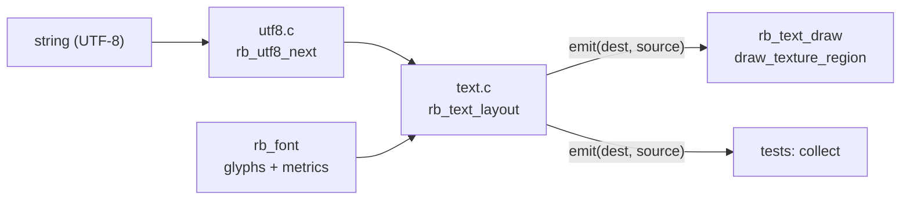

# Text

| | |
|---|---|
| **Status** | In progress |
| **Since** | v0.2.0 (2026-11-24) |
| **Updated** | v0.2.0 (2026-11-24) |
| **Code** | `engine/include/reborn/text.h`, `engine/src/text/text.c`, `engine/src/text/utf8.c` |
| **ADRs** | [0021](../adr/0021-text-rendering.md) |

## Summary
Strings drawn with a font (see [Fonts](font.md)): measured before drawing, aligned to a point, on
several lines, at a size in the current space (window pixels or world units). UTF-8 input.

## Spec
- **Style:** `rb_text_style {font, size, color, align_x, align_y}`, reused across calls. `size` is
  the height of a line (ascent + descent) in the current space: 32 in pixels draws the builtin
  font x4. Fields left out are zero: left, top, and a transparent color (always give `color`).
  A size of 0 or less draws nothing and measures zero.
- **Anchor:** `(x, y)`. Horizontally each line starts at `x` (left), is centered on it, or ends at
  it (right). Vertically the block's top, middle or bottom is at `y`, or the first line's baseline.
  Measured on the font's metrics, not on the ink: a line does not move when its characters change.
- **Lines:** `\n` starts a new one, `ascent + descent + line_gap` (scaled) below; each line is
  aligned on its own width. A line's width is the sum of its advances, trailing spaces included.
  An empty string is one empty line.
- **Measuring:** `rb_text_measure` → `{widest line, block height}`; height is
  `n * (ascent + descent) + (n - 1) * line_gap`, scaled, for `n` lines. Callable anywhere.
- **UTF-8:** decoded; a character the font lacks, or a broken sequence (lone continuation byte,
  truncated sequence, overlong form, surrogate, beyond U+10FFFF), shows the missing glyph once.
  Only `\n` is special: tabs and other control characters are glyphs.
- **Drawing:** one `rb_renderer_draw_texture_region` per visible glyph, only inside `render`.
  Nothing is allocated or kept.
- **Sharpness:** bitmap text is sharp in pixels at a whole multiple of the font's height from a
  whole-pixel anchor; at other sizes (or through a camera at fractional pixel ratios) its pixels
  turn uneven. The caller chooses the size (Blink: one scale step per 180 pixels of window height).
- Not supported: word wrapping, kerning, per-character colors, right-to-left scripts, shaping.

## Design


- **Layout** (`text/text_internal.h`): `rb_text_layout(style, x, y, text, emit, context)` measures
  the block (for vertical alignment), then each line (for horizontal alignment), and calls `emit`
  with every visible glyph's rectangle in the space and in the atlas. `rb_text_draw` passes an
  `emit` that draws; the tests pass one that collects, so layout runs without a GPU.
- **Test fonts:** `struct rb_font` lives in `text/font_internal.h` and `rb_font_set_glyphs` fills
  it from a source and packed rectangles: tests build the builtin font on the stack, without an
  atlas texture.
- **UTF-8** (`text/utf8.h`): `rb_utf8_next` checks each lead's valid range for the first
  continuation byte (Unicode's table of well-formed sequences), which rejects overlong forms,
  surrogates and values past U+10FFFF without decoding them; an invalid sequence consumes its
  maximal invalid subpart and returns U+FFFD. Never reads past the `'\0'`.

## API
```c
rb_text_style title = {.font = font, .size = 32, .color = white,
                       .align_x = RB_TEXT_CENTER, .align_y = RB_TEXT_MIDDLE};
rb_text_draw(renderer, 640, 360, &title, "GAME OVER");     /* centered on (640, 360) */

char score[32];
snprintf(score, sizeof(score), "SCORE %u", points);         /* numbers: the caller formats */
rb_text_style hud = {.font = font, .size = 32, .color = white};
rb_text_draw(renderer, 24, 24, &hud, score);                /* top left at (24, 24) */

rb_vec2 size = rb_text_measure(&title, "GAME OVER");        /* 288 x 32: a panel behind it */
```

## Decisions
- `size` as the line height in the current space (ADR 0021, A1); a reusable style struct (B1).
- Anchors with horizontal and vertical alignment on the font's metrics (C1); `\n` lines aligned
  one by one (D1); UTF-8 decoded now (E1); the caller formats numbers with `snprintf` (F1).
- HUD in window pixels at an integer scale, chosen by the game (G1); a virtual resolution waits for
  smooth fonts or a low-resolution pixel-art game.
- Layout apart from drawing, tested without a GPU (H1).

## Future work
- Word wrapping to a width, kerning (with TrueType), `rb_text_drawf` if formatting repeats.
- The HUD's integer scale as an engine helper, when a second game computes it.
- A UI scaled from a reference resolution with anchors, once TrueType text is smooth.

## History
| Version | Date | Change |
|---|---|---|
| v0.2.0 | 2026-11-24 | First version: `rb_text_draw`, `rb_text_measure`, alignment, lines, UTF-8 |
