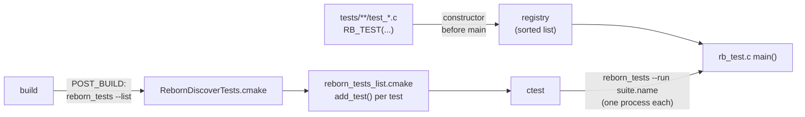

# Unit testing

| | |
|---|---|
| **Status** | Stable |
| **Since** | v0.1.0 (2026-11-15) |
| **Updated** | v0.2.0 (2026-11-24) |
| **Code** | `tests/`, `cmake/RebornTesting.cmake`, `cmake/RebornDiscoverTests.cmake`, `CMakePresets.json` (`testPresets`) |
| **ADRs** | [0004](../adr/0004-unit-testing.md) |

## Summary
A single-header test framework with no dependencies. Tests register themselves before `main`;
CTest runs each one in its own process, so a crash fails only that test.

## Spec
- `RB_EXPECT_*` records a failure and continues; `RB_REQUIRE_*` stops the test (test body only).
- Failures print `file:line: error: ...` plus the values of both operands.
- Each test is a separate CTest entry named `suite.name`; JUnit written to `build/<preset>/junit.xml`.
- Duplicate `suite.name` across files fails the build.
- Clang and GCC only. Unit tests only: platform and renderer need integration tests (backlog).
- Not yet: fixtures, testing that `RB_ASSERT` fires, fuzzing, coverage.

## Design



- Test sources are compiled directly into `reborn_tests`, never into a library: the linker would
  drop their objects (nothing references them) and the tests would disappear silently.
- `reborn_add_test_executable(<target> <sources>...)` (`cmake/RebornTesting.cmake`) makes a test
  executable: the runner, the sources, the compiler options, the discovery after each build.
  `reborn_tests` and each game's tests (`games/<name>/tests/`, e.g. `blink_tests`) use it; one
  `ctest` runs them all.
- Registry nodes are `static`: no allocation before `main`. The list is kept sorted because
  constructor order across files is unspecified.
- `stdout` is unbuffered so the output of a crashing test is not lost.
- `tests/` mirrors `engine/src/`; tests may include internal headers from `engine/src/`.
- Test helpers live in `tests/support/` (on the include path) with their own tests: the failing
  allocator walks error paths by failing the N-th allocation (see [memory.md](memory.md)).

## API

```c
#include "rb_test.h"

RB_TEST(arena, push_returns_aligned_memory) {
    rb_arena arena;
    RB_REQUIRE(rb_arena_create(&arena, RB_MIB(1)));
    void *p = rb_arena_push(&arena, 24, 16);
    RB_REQUIRE(p != NULL);
    RB_EXPECT_EQ_UINT((usize)p % 16, 0);
    rb_arena_destroy(&arena);
}
```

| Macro (`RB_EXPECT_*` / `RB_REQUIRE_*`) | Check |
|---|---|
| `(cond)` | condition is true |
| `_EQ_INT(a, b)` / `_EQ_UINT(a, b)` | integers equal (as `i64` / `u64`) |
| `_EQ_STR(a, b)` | strings equal, `NULL`-safe |
| `_NEAR(a, b, eps)` | `fabs(a - b) <= eps`; NaN fails |

```sh
ctest --preset debug                # all tests (debug-asan for sanitizers)
ctest --preset debug -R arena -j8   # filter, parallel
./build/debug/bin/reborn_tests      # all tests in one process, quickest to debug
./build/debug/bin/reborn_tests --list | --run suite.name
```

Runner exit codes: `0` passed, `1` failed, `2` usage error / unknown test / duplicate name.
CMake option: `REBORN_BUILD_TESTS` (default `ON`).

## Decisions
All in [ADR 0004](../adr/0004-unit-testing.md):
- Own framework with auto-registration, run through CTest.
- One CTest entry per test, `return`-based `REQUIRE`, no fixtures.
- Tests in `tests/` mirroring `engine/src/`; integration tests, fuzz targets, benchmarks and test
  helpers each get their own folder (`tests/integration/`, `fuzz/`, `bench/`, `tests/support/`).
- Typed macros (`_INT`, `_UINT`...) instead of `_Generic`: explicit, and `u64`/`usize` are the same
  type on Linux, which would make a `_Generic` list fail to compile.

## Future work
`longjmp`-based `REQUIRE` and an `RB_ASSERT` handler hook (death tests), fixtures, ULP float
comparisons, fuzzing (libFuzzer), coverage (`llvm-cov`).

## History
| Version | Date | Change |
|---|---|---|
| v0.1.0 | 2026-11-15 | First version |
| v0.1.0 | 2026-11-16 | `tests/support/`: failing allocator |
| v0.2.0 | 2026-11-24 | `reborn_add_test_executable`, shared with the games' tests |
